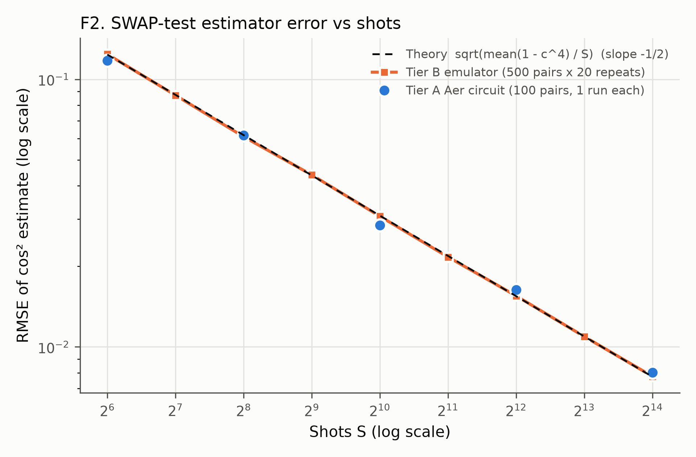
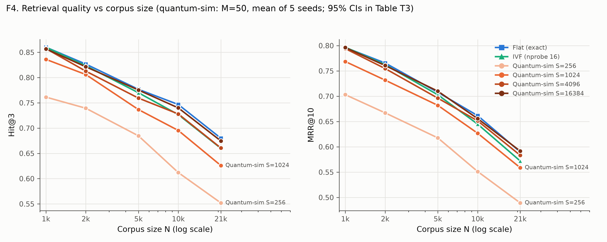
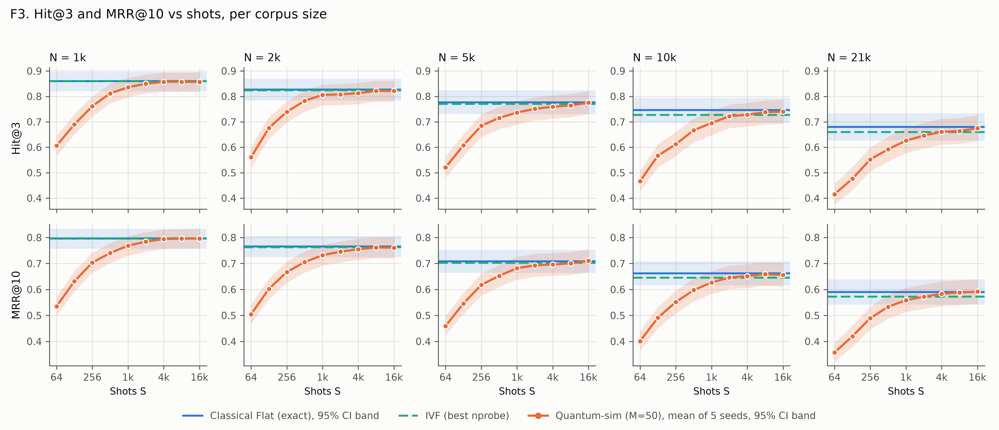
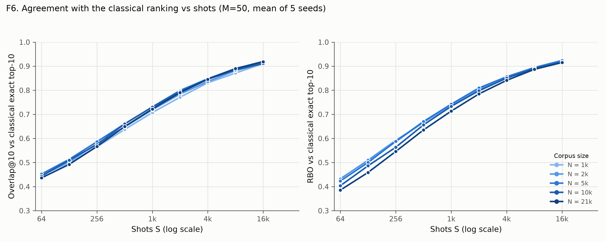
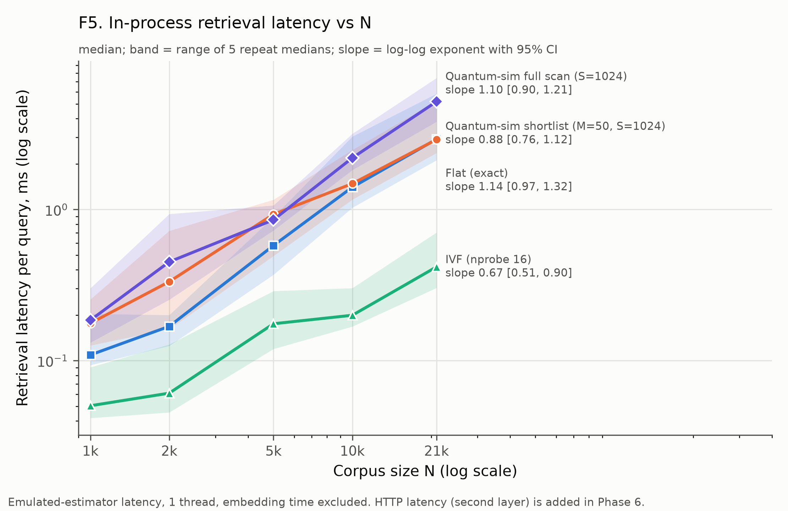
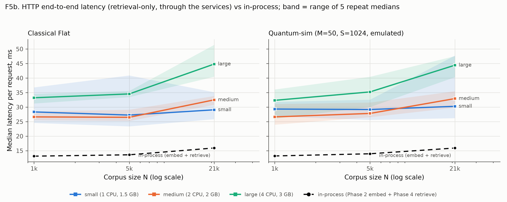
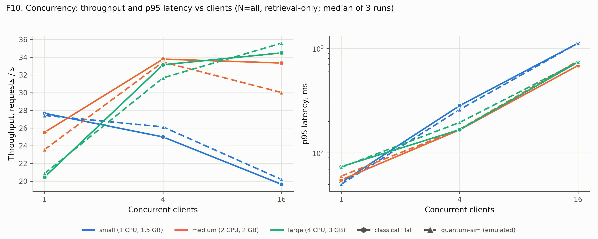

# FINDINGS

Generated blocks are rewritten by `python scripts/report.py` from artifacts under `results/`.
Do not hand-type numbers inside generated blocks (R4).

## 0. Master Results Index
<!-- BEGIN:index -->
| ID | Phase | Key result | Artifact |
|---|---|---|---|
| P0-1 | 0 | SQuAD v1.1 downloaded and checksummed | results/phase0/phase0_20261011_202243/squad_checksums.json |
| P0-2 | 0 | Generator gate: chosen = qwen2.5:1.5b-instruct | results/phase0/phase0_20261011_202243/generator_bench_summary.json |
| P0-3 | 0 | pytest: 7/7 passed | results/phase0/phase0_20261011_202243/pytest_junit.xml |
| P1-1 | 1 | 20958 unique paragraphs; 300 eval questions on 275 gold paragraphs; ladder nested, gold in every rung | results/phase1/phase1_20261011_210325/corpus_stats.json |
| P1-2 | 1 | Embedded 20958 paragraphs in 864 s (24.3/s) | results/phase1/phase1_20261011_210325/embed_info.json |
| P1-3 | 1 | Exact-cosine ceiling Hit@1 = 72.0% (N=1000) to 49.0% (N=all) | results/phase1/phase1_20261011_210325/ceiling_by_N.csv |
| P1-4 | 1 | Sanity: norms in [1.0000, 1.0000], NaN=False, gold-cosine median 0.583 | results/phase1/phase1_20261011_210325/sanity.json |
| P1-5 | 1 | Model card mentions SQuAD: True (7 squad/wiki lines) | results/phase1/phase1_20261011_210325/contamination_check.json |
| P1-6 | 1 | pytest: 14/14 passed | results/phase1/phase1_20261011_210325/pytest_junit.xml |
| P2-1 | 2 | Flat (FAISS) N=all: Hit@3 0.680, MRR@10 0.590 | results/phase2/phase2_20261011_212701/quality.csv |
| P2-2 | 2 | Flat search median 0.058 ms (N=1000) to 1.986 ms (N=all), k=50 | results/phase2/phase2_20261011_212701/latency_summary.csv |
| P2-3 | 2 | Query embedding median 13.0 ms (batch 1, CPU) | results/phase2/phase2_20261011_212701/query_embed_summary.json |
| P2-4 | 2 | Flat index 32191533 bytes at N=all | results/phase2/phase2_20261011_212701/build.csv |
| P2-5 | 2 | pytest: 19/19 passed | results/phase2/phase2_20261011_212701/pytest_junit.xml |
| P3-1 | 3 | Tier A vs Tier B KS p = 0.258; RMSE slope B -0.499, A -0.483 (theory -0.5) | results/phase3/phase3_20261011_221127/validation.json |
| P3-2 | 3 | N=all, M=50: Hit@3 classical 0.680 vs quantum-sim S=64 0.415 | results/phase3/phase3_20261011_221127/retrieval_metrics.csv |
| P3-3 | 3 | Hit@3 shot threshold (M=50) per N: 1000: 2048, 2000: 4096, 5000: 4096, 10000: 8192, all: 16384 | results/phase3/phase3_20261011_221127/shot_thresholds.csv |
| P3-4 | 3 | Tier A end-to-end: 200 circuits, 0.110 s/circuit | results/phase3/phase3_20261011_221127/tierA_e2e_summary.json |
| P3-5 | 3 | T6: full circuit depth 1083, 1076 two-qubit gates | results/phase3/phase3_20261011_221127/t6_resource_counts.json |
| P3-6 | 3 | pytest: 29/29 passed | results/phase3/phase3_20261011_221127/pytest_junit.xml |
| P4-1 | 4 | N=all: Hit@3 Flat 0.680 vs Quantum-sim S=1024 0.626 | results/phase4/phase4_20261011_223158/main_table.csv |
| P4-2 | 4 | Latency exponent b: Flat 1.14, Quantum-sim shortlist M=50 0.88 | results/phase4/phase4_20261011_223158/latency_slopes.csv |
| P4-3 | 4 | Failure analysis N=all S=256: 42 dropped / 6 gained vs classical top-3 | results/phase4/phase4_20261011_223158/failure_summary.json |
| P4-4 | 4 | Pre-registered tests: 20/30 significant after Holm | results/phase4/phase4_20261011_223158/tests.csv |
| P4-5 | 4 | pytest: 37/37 passed | results/phase4/phase4_20261011_223158/pytest_junit.xml |
| P5-1 | 5 | Classical N=all: correct 0.575, hallucination rate 0.390 | results/phase5/phase5_20261011_225152/outcomes_by_arm.csv |
| P5-6 | 5 | Regeneration check: text identical 54/60, correctness label unchanged 60/60 | results/phase5/phase5_20261011_225152/regeneration_check.json |
| P5-2 | 5 | Controls: oracle 0.860 vs closed-book 0.095 vs random 0.075 correct | results/phase5/phase5_20261011_225152/controls_check.json |
| P5-3 | 5 | T-c hallucination McNemar (Holm) at N=all: S=64 p=0.000, S=256 p=0.071, S=1024 p=0.728 | results/phase5/phase5_20261011_225152/paired_tests.csv |
| P5-4 | 5 | Audit sheet (50 rows) ready for human labels | results/audit_template.csv |
| P5-5 | 5 | pytest: 47/47 passed | results/phase5/phase5_20261011_225152/pytest_junit.xml |
| P6-1 | 6 | HTTP E2E median, medium profile, classical N=all: 32.5 ms (p95 51.6) | results/phase6/phase6_20261012_203559/latency_summary.csv |
| P6-2 | 6 | Peak throughput (medium, classical): 35.1 req/s at 16 clients; total errors 0 | results/phase6/phase6_20261012_203559/concurrency.csv |
| P6-3 | 6 | Smoke test /rag: all ok = True; Phase 5 parity [True, True, True] | results/phase6/phase6_20261012_200322/smoke_test.json |
| P6-4 | 6 | pytest: 53/53 passed | results/phase6/phase6_20261012_203559/pytest_junit.xml |
<!-- END:index -->

## 1. Environment & Versions
<!-- BEGIN:env -->
Source: `results/phase0/phase0_20261011_202243/env.json`, `results/phase0/phase0_20261011_202243/run_manifest.json` (run `phase0_20261011_202243`).

| Item | Value |
|---|---|
| OS | Windows-11-10.0.26200-SP0 |
| CPU | 11th Gen Intel(R) Core(TM) i5-1135G7 @ 2.40GHz (4 cores / 8 threads) |
| RAM | 8.33 GB |
| GPU(s) | NVIDIA GeForce MX350; Intel(R) Iris(R) Xe Graphics - ignored (H3): torch CPU wheel, Ollama CPU-only |
| Disk free / total | 284.60 GB / 510.75 GB |
| Python | 3.12.6 |
| Git | git version 2.49.0.windows.1 |
| Ollama | ollama version is 0.40.3 |
| Docker CLI | Docker version 29.8.2, build 7fc2dff |
| Docker Compose | Docker Compose version v5.5.1 |
| Docker daemon at Phase 0 | NOT running |
| Git commit at run time | none (no commits yet) (dirty=True) |

Pinned packages (full list: `requirements.lock`):

| Package | Version |
|---|---|
| numpy | 2.5.4 |
| scipy | 1.18.1 |
| pandas | 3.0.6 |
| faiss-cpu | 1.15.1 |
| sentence-transformers | 6.1.0 |
| torch | 2.14.1+cpu |
| transformers | 5.19.0 |
| qiskit | 2.5.2 |
| qiskit-aer | 0.17.2 |
| fastapi | 0.143.0 |
| uvicorn | 0.54.0 |
| httpx | 0.28.1 |
| pydantic | 2.14.0 |
| pytest | 9.1.1 |
| matplotlib | 3.11.2 |
| pyyaml | 6.0.3 |
| datasets | 5.1.0 |
| ollama | 0.6.3 |
| psutil | 7.2.2 |
<!-- END:env -->

## 2. Phase Reports

### Phase 0 - Setup, environment, scaffolding
<!-- BEGIN:phase0 -->
Run `phase0_20261011_202243` - manifest: `results/phase0/phase0_20261011_202243/run_manifest.json`.

**SQuAD v1.1** (official JSON; checksums also in `data/squad_v1.1.checksums.json`, raw files in git-ignored `data/raw/`)

| File | Bytes | Articles | Paragraphs | Questions | SHA-256 |
|---|---|---|---|---|---|
| train-v1.1.json | 30288272 | 442 | 18896 | 87599 | `3527663986b8295af4f7fcdff1ba1ff3f72d07d61a20f487cb238a6ef92fd955` |
| dev-v1.1.json | 4854279 | 48 | 2067 | 10570 | `95aa6a52d5d6a735563366753ca50492a658031da74f301ac5238b03966972c9` |

**Generator benchmark gate (H2)** - CPU-only, options `{"temperature": 0, "seed": 42, "num_ctx": 2048, "num_predict": 48, "num_gpu": 0}`, 10 fixed RAG-style prompts, 1 discarded warm-up.
Decision rule: largest passing (a) median<=10s (b) peak RAM<=2.5GB (c) >=8/10 clean. Source: `results/phase0/phase0_20261011_202243/generator_bench_summary.json`, per-prompt rows `results/phase0/phase0_20261011_202243/generator_bench.csv`.

| Model | Median s/query | p95 s | Median tok/s | Median prompt tok | Median prompt-eval s | Ollama working set (GB) | System RAM drop (GB) | ollama ps size (GB) | RAM metric used for (b) (GB) | Min free RAM (GB) | Swap delta (MB) | Clean | Warm-up+load s | Gate |
|---|---|---|---|---|---|---|---|---|---|---|---|---|---|---|
| qwen2.5:1.5b-instruct | 6.284 | 8.043 | 21.89 | 623.0 | 5.49 | 0.032 | 1.113 | 1.109 | 1.113 | 0.994 | 171.0 | 10/10 | 6.21 | PASS |
| llama3.2:1b | 9.201 | 11.536 | 18.81 | 615.5 | 8.463 | 0.033 | 1.469 | 1.45 | 1.469 | 0.845 | 41.7 | 10/10 | 10.77 | PASS |
| llama3.2:3b | 13.085 | 16.58 | 11.06 | 615.5 | 12.256 | 0.033 | 2.485 | 2.325 | 2.485 | 0.259 | 465.8 | 10/10 | 16.02 | FAIL (a) |

**Chosen generator: `qwen2.5:1.5b-instruct`**

- `qwen2.5:1.5b-instruct` digest `65ec06548149b04c096a120e4a6da9d4017ea809c91734ea5631e89f96ddc57b`; Ollama `ps` after warm-up: `[{"name": "qwen2.5:1.5b-instruct", "size": 1109162720, "size_vram": 0}]`
- `llama3.2:1b` digest `baf6a787fdffd633537aa2eb51cfd54cb93ff08e28040095462bb63daf552878`; Ollama `ps` after warm-up: `[{"name": "llama3.2:1b", "size": 1450086235, "size_vram": 0}]`
- `llama3.2:3b` digest `a80c4f17acd55265feec403c7aef86be0c25983ab279d83f3bcd3abbcb5b8b72`; Ollama `ps` after warm-up: `[{"name": "llama3.2:3b", "size": 2324546189, "size_vram": 0}]`

**pytest**: 7 tests, 0 failures, 0 errors, 0 skipped (`results/phase0/phase0_20261011_202243/pytest_junit.xml`).

**Manuscript hook**: Section 5 (Experimental setup: LLM, hardware) and Table T2.
<!-- END:phase0 -->

### Phase 1 - Corpus, embeddings, eval set, ground truth
<!-- BEGIN:phase1 -->
Run `phase1_20261011_210325` - manifest: `results/phase1/phase1_20261011_210325/run_manifest.json`; config: seeds 42, eval n=300, ladder 1k/2k/5k/10k/all, ground-truth k=50.

**T1a corpus / eval set** (`results/phase1/phase1_20261011_210325/corpus_stats.json`)

| Quantity | Value |
|---|---|
| Raw paragraphs train / dev | 18896 / 2067 |
| Exact duplicates dropped | 5 |
| Unique paragraphs | 20958 |
| Dev questions with gold paragraph in corpus | 10570 |
| Eval questions (seed 42) | 300 |
| Distinct gold paragraphs among eval questions | 275 |
| Words per paragraph mean / median / p95 / max | 117.2 / 108 / 210 / 653 |
| Ladder nested | True |
| Gold in every rung | True |

**T1b corpus ladder** (`data/ladder_N.json`)

| Rung | Paragraphs | Gold included | Distractors |
|---|---|---|---|
| 1000 | 1000 | 275 | 725 |
| 2000 | 2000 | 275 | 1725 |
| 5000 | 5000 | 275 | 4725 |
| 10000 | 10000 | 275 | 9725 |
| all | 20958 | 275 | 20683 |

**Embedding** (`results/phase1/phase1_20261011_210325/embed_info.json`)

| Item | Value |
|---|---|
| Model / revision | `sentence-transformers/all-MiniLM-L6-v2` @ `1110a243fdf4706b3f48f1d95db1a4f5529b4d41` |
| Device / torch threads / batch | cpu / 4 / 64 |
| Dim / padded dim | 384 / 512 |
| Paragraph embedding time | 864.0 s (24.3 paragraphs/s) |
| Query embedding time | 1.73 s (173.5 queries/s) |
| Process RSS after embedding | 0.54 GB |
| max_seq_length (tokens) | 256 |
| Paragraph tokens mean / median / max | 154.4 / 142 / 855 |
| Paragraphs truncated by max_seq_length | 1494 (7.1%) |

**Classical ceiling: exact cosine vs gold paragraph, 300 queries** (`results/phase1/phase1_20261011_210325/ceiling_by_N.csv`; top-50 ground truth in `results/phase1/phase1_20261011_210325/ground_truth_N*.npz`)

| N | Corpus size | Hit@1 | Hit@3 | Hit@5 | Hit@10 | P@1 | P@3 | P@5 | P@10 | MRR@10 | nDCG@10 | Median gold rank | Brute-force s (300 q) |
|---|---|---|---|---|---|---|---|---|---|---|---|---|---|
| 1000 | 1000 | 0.720 | 0.860 | 0.900 | 0.940 | 0.720 | 0.287 | 0.180 | 0.094 | 0.796 | 0.831 | 1.0 | 0.024 |
| 2000 | 2000 | 0.690 | 0.827 | 0.873 | 0.917 | 0.690 | 0.276 | 0.175 | 0.092 | 0.766 | 0.802 | 1.0 | 0.044 |
| 5000 | 5000 | 0.623 | 0.777 | 0.817 | 0.880 | 0.623 | 0.259 | 0.163 | 0.088 | 0.708 | 0.749 | 1.0 | 0.099 |
| 10000 | 10000 | 0.573 | 0.747 | 0.783 | 0.833 | 0.573 | 0.249 | 0.157 | 0.083 | 0.662 | 0.703 | 1.0 | 0.233 |
| all | 20958 | 0.490 | 0.680 | 0.733 | 0.783 | 0.490 | 0.227 | 0.147 | 0.078 | 0.590 | 0.637 | 2.0 | 0.563 |

Note: P@k is upper-bounded by 1/k with a single gold paragraph (A.4).

**Data sanity** (`results/phase1/phase1_20261011_210325/sanity.json`, `results/phase1/phase1_20261011_210325/gold_cosine.csv`)

| Check | Result |
|---|---|
| NaNs in embeddings | False |
| Paragraph norm min / max | 1.000000 / 1.000000 |
| Query norm min / max | 1.000000 / 1.000000 |
| 512-d padded norm max abs deviation from 1 | 1.19e-07 |
| Gold cosine change from padding (max abs) | 0.00e+00 |
| Padding columns all zero | True |
| Question-gold cosine min / p5 / median / p95 / max | 0.006 / 0.259 / 0.583 / 0.759 / 0.833 |
| Negative cosines in exact top-10 (per rung) | 1000: 0, 2000: 0, 5000: 0, 10000: 0, all: 0 |
| Min top-10 cosine (per rung) | 1000: 0.182, 2000: 0.198, 5000: 0.219, 10000: 0.253, all: 0.272 |

**Embedder contamination check (D7)** - model card saved at `results/phase1/phase1_20261011_210325/model_card.md` (revision `1110a243fdf4706b3f48f1d95db1a4f5529b4d41`, 175 lines). Card mentions SQuAD: **True**. Lines mentioning squad/wikipedia/wiki:

- line 23: `- wikihow`
- line 29: `- embedding-data/simple-wiki`
- line 33: `- embedding-data/WikiAnswers`
- line 145: `| [WikiAnswers](https://github.com/afader/oqa#wikianswers-corpus) Duplicate question pairs | [paper](https://doi.org/10.1145/2623330.2623677) | 77,427,422 |`
- line 168: `| [Wikihow](https://github.com/pvl/wikihow_pairs_dataset) | [paper](https://arxiv.org/abs/1810.09305) | 128,542 |`
- line 171: `| [Simple Wikipedia](https://cs.pomona.edu/~dkauchak/simplification/) | [paper](https://www.aclweb.org/anthology/P11-2117/) | 102,225 |`
- line 173: `| [SQuAD2.0](https://rajpurkar.github.io/SQuAD-explorer/) | [paper](https://aclanthology.org/P18-2124.pdf) | 87,599 |`

Interpretation: see Section 5. A model card cannot prove absence of overlap.

**pytest** (whole suite at Phase 1 exit): 14 tests, 0 failures, 0 errors, 0 skipped (`results/phase1/phase1_20261011_210325/pytest_junit.xml`).

**Manuscript hook**: Section 5 (corpus, ladder, embeddings), Table T1; contamination discussion in Section 11.
<!-- END:phase1 -->

### Phase 2 - Classical baseline (FAISS)
<!-- BEGIN:phase2 -->
Run `phase2_20261011_212701` - manifest: `results/phase2/phase2_20261011_212701/run_manifest.json`. FAISS single-threaded, in-process; quality on 300 queries (bootstrap 95% CI, 10k resamples); latency: batch-1 queries, 10 warm-up discarded, 100 timed, 5 repeats, conditions shuffled per repeat.

**Classical Flat (exact) retrieval quality via FAISS IndexFlatIP** (`results/phase2/phase2_20261011_212701/quality.csv`)

| N | Hit@1 | Hit@3 | Hit@5 | Hit@10 | MRR@10 | nDCG@10 | P@3 | P@10 |
|---|---|---|---|---|---|---|---|---|
| 1000 | 0.720 [0.670, 0.770] | 0.860 [0.820, 0.897] | 0.900 [0.863, 0.933] | 0.940 [0.913, 0.967] | 0.796 [0.757, 0.834] | 0.831 [0.797, 0.864] | 0.287 | 0.094 |
| 2000 | 0.690 [0.637, 0.740] | 0.827 [0.783, 0.870] | 0.873 [0.833, 0.910] | 0.917 [0.883, 0.947] | 0.766 [0.724, 0.806] | 0.802 [0.765, 0.838] | 0.276 | 0.092 |
| 5000 | 0.623 [0.570, 0.680] | 0.777 [0.730, 0.823] | 0.817 [0.773, 0.860] | 0.880 [0.843, 0.917] | 0.708 [0.664, 0.752] | 0.749 [0.709, 0.790] | 0.259 | 0.088 |
| 10000 | 0.573 [0.517, 0.630] | 0.747 [0.697, 0.793] | 0.783 [0.737, 0.830] | 0.833 [0.790, 0.873] | 0.662 [0.616, 0.709] | 0.703 [0.660, 0.746] | 0.249 | 0.083 |
| all | 0.490 [0.433, 0.547] | 0.680 [0.627, 0.733] | 0.733 [0.683, 0.783] | 0.783 [0.737, 0.830] | 0.590 [0.542, 0.638] | 0.637 [0.592, 0.682] | 0.227 | 0.078 |

FAISS Flat vs numpy brute force (`results/phase2/phase2_20261011_212701/flat_vs_numpy_check.json`): fraction of queries with identical top-50 list / identical top-10 set: N=1000: 1.000 / 1.000; N=2000: 1.000 / 1.000; N=5000: 1.000 / 1.000; N=10000: 1.000 / 1.000; N=all: 1.000 / 1.000

**IVFFlat nprobe sweep** (nlist = round(sqrt N); k-means seed 42; Overlap@10 = recall of exact top-10; latency k=50, ms)

| N | nlist | nprobe | Overlap@10 vs exact | Hit@3 | Hit@10 | MRR@10 | median ms | p95 ms |
|---|---|---|---|---|---|---|---|---|
| 1000 | 32 | 1 | 0.574 | 0.650 [0.597, 0.703] | 0.700 [0.647, 0.750] | 0.600 | 0.010 | 0.013 |
| 1000 | 32 | 2 | 0.744 | 0.753 [0.703, 0.800] | 0.810 [0.767, 0.853] | 0.696 | 0.014 | 0.030 |
| 1000 | 32 | 4 | 0.854 | 0.823 [0.780, 0.867] | 0.897 [0.860, 0.930] | 0.764 | 0.020 | 0.039 |
| 1000 | 32 | 8 | 0.935 | 0.843 [0.800, 0.883] | 0.917 [0.883, 0.947] | 0.780 | 0.026 | 0.040 |
| 1000 | 32 | 16 | 0.986 | 0.860 [0.820, 0.897] | 0.943 [0.917, 0.967] | 0.797 | 0.038 | 0.064 |
| 1000 | 32 | 32 | 1.000 | 0.860 [0.820, 0.897] | 0.940 [0.913, 0.967] | 0.796 | 0.061 | 0.090 |
| 2000 | 45 | 1 | 0.584 | 0.620 [0.563, 0.673] | 0.667 [0.613, 0.720] | 0.578 | 0.013 | 0.019 |
| 2000 | 45 | 2 | 0.723 | 0.737 [0.687, 0.787] | 0.797 [0.750, 0.840] | 0.685 | 0.018 | 0.040 |
| 2000 | 45 | 4 | 0.835 | 0.787 [0.740, 0.830] | 0.857 [0.817, 0.893] | 0.729 | 0.023 | 0.037 |
| 2000 | 45 | 8 | 0.915 | 0.817 [0.773, 0.860] | 0.900 [0.863, 0.933] | 0.757 | 0.032 | 0.051 |
| 2000 | 45 | 16 | 0.973 | 0.823 [0.780, 0.867] | 0.913 [0.880, 0.943] | 0.762 | 0.052 | 0.070 |
| 2000 | 45 | 32 | 0.998 | 0.827 [0.783, 0.870] | 0.917 [0.883, 0.947] | 0.766 | 0.090 | 0.168 |
| 5000 | 71 | 1 | 0.573 | 0.507 [0.450, 0.563] | 0.540 [0.483, 0.597] | 0.468 | 0.018 | 0.032 |
| 5000 | 71 | 2 | 0.730 | 0.653 [0.600, 0.707] | 0.727 [0.677, 0.777] | 0.608 | 0.025 | 0.034 |
| 5000 | 71 | 4 | 0.836 | 0.720 [0.670, 0.770] | 0.810 [0.767, 0.853] | 0.666 | 0.039 | 0.076 |
| 5000 | 71 | 8 | 0.905 | 0.750 [0.700, 0.797] | 0.850 [0.810, 0.890] | 0.689 | 0.061 | 0.119 |
| 5000 | 71 | 16 | 0.958 | 0.770 [0.720, 0.817] | 0.867 [0.827, 0.903] | 0.703 | 0.101 | 0.154 |
| 5000 | 71 | 32 | 0.988 | 0.773 [0.727, 0.820] | 0.877 [0.840, 0.913] | 0.707 | 0.191 | 0.397 |
| 10000 | 100 | 1 | 0.596 | 0.480 [0.423, 0.537] | 0.530 [0.473, 0.587] | 0.422 | 0.024 | 0.051 |
| 10000 | 100 | 2 | 0.735 | 0.580 [0.523, 0.637] | 0.653 [0.600, 0.707] | 0.523 | 0.033 | 0.048 |
| 10000 | 100 | 4 | 0.847 | 0.687 [0.633, 0.737] | 0.760 [0.710, 0.807] | 0.617 | 0.057 | 0.108 |
| 10000 | 100 | 8 | 0.920 | 0.723 [0.673, 0.773] | 0.803 [0.757, 0.847] | 0.642 | 0.102 | 0.230 |
| 10000 | 100 | 16 | 0.965 | 0.727 [0.677, 0.777] | 0.807 [0.760, 0.850] | 0.645 | 0.180 | 0.274 |
| 10000 | 100 | 32 | 0.985 | 0.740 [0.690, 0.790] | 0.820 [0.777, 0.863] | 0.656 | 0.377 | 0.737 |
| all | 145 | 1 | 0.572 | 0.453 [0.400, 0.510] | 0.500 [0.443, 0.557] | 0.394 | 0.030 | 0.044 |
| all | 145 | 2 | 0.718 | 0.543 [0.487, 0.600] | 0.620 [0.563, 0.673] | 0.476 | 0.045 | 0.058 |
| all | 145 | 4 | 0.824 | 0.580 [0.527, 0.633] | 0.663 [0.610, 0.717] | 0.500 | 0.077 | 0.110 |
| all | 145 | 8 | 0.900 | 0.643 [0.590, 0.697] | 0.737 [0.687, 0.787] | 0.555 | 0.134 | 0.231 |
| all | 145 | 16 | 0.953 | 0.660 [0.607, 0.713] | 0.760 [0.710, 0.807] | 0.572 | 0.238 | 0.376 |
| all | 145 | 32 | 0.981 | 0.673 [0.620, 0.727] | 0.780 [0.733, 0.827] | 0.585 | 0.497 | 0.915 |

Best nprobe per N (smallest nprobe with mean Overlap@10 vs exact >= 0.95; else largest swept, `results/phase2/phase2_20261011_212701/best_nprobe.json`): N=1000: nprobe 16 (target met: True), N=2000: nprobe 16 (target met: True), N=5000: nprobe 16 (target met: True), N=10000: nprobe 16 (target met: True), N=all: nprobe 16 (target met: True)

**T4a Search latency per query, k=50** (`results/phase2/phase2_20261011_212701/latency_summary.csv`; raw samples `results/phase2/phase2_20261011_212701/latency_raw.csv`)

| N | Flat median ms | Flat p95 ms | Flat run-to-run range of repeat medians (ms) | IVF best nprobe | IVF median ms | IVF p95 ms |
|---|---|---|---|---|---|---|
| 1000 | 0.058 | 0.077 | 0.058-0.065 | 16 | 0.038 | 0.064 |
| 2000 | 0.104 | 0.169 | 0.104-0.105 | 16 | 0.052 | 0.070 |
| 5000 | 0.355 | 0.656 | 0.340-0.515 | 16 | 0.101 | 0.154 |
| 10000 | 0.937 | 2.010 | 0.896-1.785 | 16 | 0.180 | 0.274 |
| all | 1.986 | 4.308 | 1.729-3.793 | 16 | 0.238 | 0.376 |

Flat search median ms by k (shortlist sizes used in Phase 3):

| N | k=10 | k=50 | k=100 |
|---|---|---|---|
| 1000 | 0.050 | 0.058 | 0.073 |
| 2000 | 0.099 | 0.104 | 0.119 |
| 5000 | 0.377 | 0.355 | 0.430 |
| 10000 | 0.900 | 0.937 | 0.989 |
| all | 1.954 | 1.986 | 1.855 |

**Query embedding latency** (`results/phase2/phase2_20261011_212701/query_embed_summary.json`): median 13.02 ms, p95 22.23 ms, n=500, repeat medians 10.98-15.98 ms (batch size 1, CPU, torch threads 4, includes tokenisation).

Stage breakdown at N=all (median ms): embed query 13.02 + Flat search 1.986.

**Index build time and footprint** (`results/phase2/phase2_20261011_212701/build.csv`; median of 3 builds, IVF includes k-means training)

| Arm | N | nlist | Build s | Index bytes | Bytes/vector | Raw vectors bytes |
|---|---|---|---|---|---|---|
| flat | 1000 |  | 0.0005 | 1536045 | 1536.0 | 1536000 |
| ivf | 1000 | 32 | 0.0080 | 1593547 | 1593.5 | 1536000 |
| flat | 2000 |  | 0.0010 | 3072045 | 1536.0 | 3072000 |
| ivf | 2000 | 45 | 0.0163 | 3157619 | 1578.8 | 3072000 |
| flat | 5000 |  | 0.0022 | 7680045 | 1536.0 | 7680000 |
| ivf | 5000 | 71 | 0.0399 | 7829763 | 1566.0 | 7680000 |
| flat | 10000 |  | 0.0041 | 15360045 | 1536.0 | 15360000 |
| ivf | 10000 | 100 | 0.0530 | 15594539 | 1559.5 | 15360000 |
| flat | all |  | 0.0088 | 32191533 | 1536.0 | 32191488 |
| ivf | all | 145 | 0.0963 | 32583171 | 1554.7 | 32191488 |

**Measurement hygiene (H7)** (`results/phase2/phase2_20261011_212701/hygiene.json`): plugged in = True, battery 100%, power scheme: `Power Scheme GUID: 381b4222-f694-41f0-9685-ff5bb260df2e  (Balanced)`, FAISS threads = 1, CPU temperature: not monitored (no sensor tool on this host); cpu_freq per repeat logged as throttling proxy. Reported CPU MHz at repeat boundaries: min 2419, max 2419. conditions shuffled per repeat (seeded) so thermal drift hits all conditions alike (H7).

Peak working set of the benchmark process after each stage (GB, cumulative; `results/phase2/phase2_20261011_212701/stage_peak_rss_gb.json`): quality: 0.40, build: 0.49, latency: 0.49, qembed: 0.66

**pytest** (whole suite at Phase 2 exit): 19 tests, 0 failures, 0 errors, 0 skipped (`results/phase2/phase2_20261011_212701/pytest_junit.xml`).

**Manuscript hook**: Section 9 (latency), Section 7 (classical baseline), Table T4.
<!-- END:phase2 -->

### Phase 3 - Quantum-inspired retrieval arm + validation
<!-- BEGIN:phase3 -->
Run `phase3_20261011_221127` - manifest: `results/phase3/phase3_20261011_221127/run_manifest.json`. Quantum-inspired arm = classical SIMULATION of the SWAP test (Appendix A.1); no speedup is claimed. Tier B latency is emulated-estimator latency, not quantum latency.

**Tier A circuit cost on this laptop (3.3, first step)** (`results/phase3/phase3_20261011_221127/tierA_timing.json`): 19 qubits, S=4096, median per pair 0.247 s with transpile, 0.129 s without; identical estimates in both modes: True. Tier B chunk (20 queries x 20958 candidates, S=1024, incl. ranking): 0.180 s. Decision: Tier A runs WITHOUT transpile (Aer executes set_statevector/h/cswap natively; same seed gives identical estimates) - per-pair cost below 2 s, no pair-count reduction needed.

**Validation (3.3a/b)** (`results/phase3/phase3_20261011_221127/validation.json`, per-pair `results/phase3/phase3_20261011_221127/validation_pairs.csv`): 500 pairs (250 random corpus pairs + 250 query-to-exact-top-50 pairs; cos range -0.160 to 0.821), S = 4096, unclipped estimates. Theory RMSE = 0.0155.

| Tier | Bias | MAE | RMSE | z sd (theory 1) | |z|<=2 | |z|<=3 | KS vs N(0,1) p |
|---|---|---|---|---|---|---|---|
| A (Aer circuit) | +0.00039 | 0.0127 | 0.0161 | 1.046 | 0.944 | 0.996 | 0.897 |
| B (emulator) | -0.00044 | 0.0121 | 0.0157 | 1.014 | 0.950 | 0.998 | 0.063 |

Two-sample KS on standardised errors, Tier A vs Tier B: D = 0.064, p = 0.258.

Repeated estimates (50 pairs x 20 repeats per tier, S=4096; `results/phase3/phase3_20261011_221127/validation_repeated.npz`): mean |difference of pair means| = 0.0038 (expected under equivalence ~0.0049 sd); variance ratio A/B median 0.994 (IQR 0.690-1.287); variance / theory: A 1.006, B 1.018; pooled two-sample KS D = 0.067, p = 0.022.

**F2 error vs shots (3.3c)**:  (data `results/figures/F2_error_vs_shots.csv`, source `results/phase3/phase3_20261011_221127/f2_error_vs_shots.csv`). Log-log slope of RMSE vs S: Tier B -0.499 (95% CI -0.502 to -0.497); Tier A -0.483 (95% CI -0.507 to -0.460); theory -0.5.

**Negative-cosine audit (3.3d)** (`results/phase3/phase3_20261011_221127/negative_cosine_audit.json`)

| N | cos<0 in exact top-10 | cos<0 in exact top-100 | Queries whose noise-free cos² full-scan top-10 differs from cos top-10 | Min cos in corpus |
|---|---|---|---|---|
| 1000 | 0 | 0 | 4 | -0.275 |
| 2000 | 0 | 0 | 4 | -0.279 |
| 5000 | 0 | 0 | 2 | -0.312 |
| 10000 | 0 | 0 | 0 | -0.318 |
| all | 0 | 0 | 0 | -0.321 |

The last-but-one column measures the sign loss of cos² (D1) in the full-scan protocol: strongly negative items square above weakly positive top-10 items. Shortlist protocols (M <= 100) contain no negative cosines, so they are unaffected.

**Quantum-sim retrieval, two-stage (M=50 shortlist from Flat, Tier B re-score, ties by classical score), 300 queries, 5 seeds** (`results/phase3/phase3_20261011_221127/retrieval_metrics.csv`; rankings `results/phase3/phase3_20261011_221127/rankings/`). Values: mean ± sd across seeds; [95% bootstrap CI over queries, seed-averaged]; diff = quantum - classical Hit@3 (paired bootstrap CI).

| N | Shots S | Hit@3 | Hit@3 CI | MRR@10 | Overlap@10 | RBO | Top-1 changed | Kendall tau (M items) | diff Hit@3 [CI] |
|---|---|---|---|---|---|---|---|---|---|
| 1000 | classical | 0.860 | [0.820, 0.897] | 0.796 | 1 | 1 | 0 | 1 | - |
| 1000 | 64 | 0.606 ± 0.014 | [0.565, 0.647] | 0.535 ± 0.013 | 0.447 | 0.433 | 0.533 | 0.205 | -0.254 [-0.291, -0.219] |
| 1000 | 256 | 0.761 ± 0.011 | [0.721, 0.801] | 0.703 ± 0.013 | 0.565 | 0.586 | 0.306 | 0.318 | -0.099 [-0.129, -0.071] |
| 1000 | 1024 | 0.836 ± 0.014 | [0.797, 0.873] | 0.769 ± 0.008 | 0.707 | 0.737 | 0.157 | 0.468 | -0.024 [-0.046, -0.003] |
| 1000 | 4096 | 0.857 ± 0.012 | [0.819, 0.894] | 0.794 ± 0.008 | 0.831 | 0.852 | 0.081 | 0.624 | -0.003 [-0.013, +0.007] |
| 1000 | 16384 | 0.857 ± 0.002 | [0.817, 0.894] | 0.796 ± 0.005 | 0.910 | 0.920 | 0.046 | 0.760 | -0.003 [-0.013, +0.006] |
| 1000 | inf | 0.860 ± 0.000 | [0.820, 0.897] | 0.796 ± 0.000 | 1.000 | 1.000 | 0.000 | 1.000 | +0.000 [+0.000, +0.000] |
| 2000 | classical | 0.827 | [0.783, 0.870] | 0.766 | 1 | 1 | 0 | 1 | - |
| 2000 | 64 | 0.561 ± 0.026 | [0.519, 0.603] | 0.504 ± 0.028 | 0.450 | 0.432 | 0.550 | 0.216 | -0.266 [-0.304, -0.228] |
| 2000 | 256 | 0.739 ± 0.010 | [0.697, 0.780] | 0.667 ± 0.010 | 0.578 | 0.592 | 0.311 | 0.339 | -0.087 [-0.115, -0.061] |
| 2000 | 1024 | 0.806 ± 0.006 | [0.765, 0.846] | 0.732 ± 0.008 | 0.719 | 0.742 | 0.171 | 0.490 | -0.021 [-0.041, +0.000] |
| 2000 | 4096 | 0.813 ± 0.008 | [0.770, 0.853] | 0.755 ± 0.003 | 0.836 | 0.852 | 0.102 | 0.645 | -0.014 [-0.029, +0.001] |
| 2000 | 16384 | 0.821 ± 0.006 | [0.779, 0.861] | 0.761 ± 0.003 | 0.911 | 0.921 | 0.055 | 0.777 | -0.005 [-0.020, +0.009] |
| 2000 | inf | 0.827 ± 0.000 | [0.783, 0.870] | 0.766 ± 0.000 | 1.000 | 1.000 | 0.000 | 1.000 | +0.000 [+0.000, +0.000] |
| 5000 | classical | 0.777 | [0.730, 0.823] | 0.708 | 1 | 1 | 0 | 1 | - |
| 5000 | 64 | 0.521 ± 0.034 | [0.479, 0.563] | 0.459 ± 0.029 | 0.452 | 0.423 | 0.600 | 0.221 | -0.256 [-0.294, -0.219] |
| 5000 | 256 | 0.685 ± 0.013 | [0.640, 0.729] | 0.618 ± 0.011 | 0.586 | 0.588 | 0.368 | 0.361 | -0.092 [-0.121, -0.064] |
| 5000 | 1024 | 0.737 ± 0.012 | [0.690, 0.781] | 0.682 ± 0.011 | 0.731 | 0.742 | 0.198 | 0.517 | -0.040 [-0.062, -0.019] |
| 5000 | 4096 | 0.759 ± 0.005 | [0.713, 0.804] | 0.696 ± 0.007 | 0.848 | 0.856 | 0.103 | 0.675 | -0.017 [-0.035, +0.000] |
| 5000 | 16384 | 0.775 ± 0.005 | [0.729, 0.820] | 0.710 ± 0.004 | 0.920 | 0.924 | 0.050 | 0.802 | -0.001 [-0.014, +0.011] |
| 5000 | inf | 0.777 ± 0.000 | [0.730, 0.823] | 0.708 ± 0.000 | 1.000 | 1.000 | 0.000 | 1.000 | +0.000 [+0.000, +0.000] |
| 10000 | classical | 0.747 | [0.697, 0.793] | 0.662 | 1 | 1 | 0 | 1 | - |
| 10000 | 64 | 0.467 ± 0.027 | [0.427, 0.507] | 0.401 ± 0.016 | 0.443 | 0.404 | 0.630 | 0.222 | -0.280 [-0.319, -0.242] |
| 10000 | 256 | 0.612 ± 0.015 | [0.565, 0.659] | 0.551 ± 0.007 | 0.574 | 0.563 | 0.425 | 0.364 | -0.135 [-0.167, -0.103] |
| 10000 | 1024 | 0.695 ± 0.014 | [0.648, 0.743] | 0.627 ± 0.016 | 0.731 | 0.733 | 0.231 | 0.535 | -0.051 [-0.073, -0.031] |
| 10000 | 4096 | 0.728 ± 0.009 | [0.681, 0.775] | 0.651 ± 0.003 | 0.846 | 0.850 | 0.127 | 0.690 | -0.019 [-0.033, -0.005] |
| 10000 | 16384 | 0.740 ± 0.005 | [0.691, 0.787] | 0.656 ± 0.005 | 0.911 | 0.917 | 0.074 | 0.816 | -0.007 [-0.016, +0.003] |
| 10000 | inf | 0.747 ± 0.000 | [0.697, 0.793] | 0.662 ± 0.000 | 1.000 | 1.000 | 0.000 | 1.000 | +0.000 [+0.000, +0.000] |
| all | classical | 0.680 | [0.627, 0.733] | 0.590 | 1 | 1 | 0 | 1 | - |
| all | 64 | 0.415 ± 0.022 | [0.375, 0.457] | 0.357 ± 0.005 | 0.436 | 0.385 | 0.686 | 0.221 | -0.265 [-0.304, -0.225] |
| all | 256 | 0.552 ± 0.012 | [0.505, 0.600] | 0.489 ± 0.006 | 0.566 | 0.546 | 0.469 | 0.365 | -0.128 [-0.160, -0.097] |
| all | 1024 | 0.626 ± 0.015 | [0.577, 0.675] | 0.559 ± 0.008 | 0.722 | 0.713 | 0.299 | 0.537 | -0.054 [-0.078, -0.031] |
| all | 4096 | 0.661 ± 0.006 | [0.611, 0.711] | 0.583 ± 0.005 | 0.845 | 0.841 | 0.165 | 0.699 | -0.019 [-0.035, -0.004] |
| all | 16384 | 0.675 ± 0.004 | [0.623, 0.725] | 0.592 ± 0.003 | 0.918 | 0.915 | 0.093 | 0.823 | -0.005 [-0.016, +0.005] |
| all | inf | 0.680 ± 0.000 | [0.627, 0.733] | 0.590 ± 0.000 | 1.000 | 1.000 | 0.000 | 1.000 | +0.000 [+0.000, +0.000] |

**Full-scan ablation (all N candidates estimated, Tier B)**

| N | Shots S | Hit@3 | MRR@10 | Overlap@10 | Top-1 changed | diff Hit@3 [CI] |
|---|---|---|---|---|---|---|
| 1000 | 64 | 0.457 ± 0.016 | 0.405 ± 0.011 | 0.195 | 0.631 | -0.403 [-0.447, -0.361] |
| 1000 | 256 | 0.741 ± 0.010 | 0.681 ± 0.004 | 0.406 | 0.315 | -0.119 [-0.152, -0.089] |
| 1000 | 1024 | 0.836 ± 0.010 | 0.768 ± 0.007 | 0.657 | 0.168 | -0.024 [-0.042, -0.007] |
| 1000 | 4096 | 0.857 ± 0.004 | 0.790 ± 0.007 | 0.824 | 0.094 | -0.003 [-0.016, +0.011] |
| 1000 | 16384 | 0.863 ± 0.005 | 0.796 ± 0.003 | 0.909 | 0.050 | +0.003 [-0.008, +0.013] |
| 1000 | inf | 0.860 ± 0.000 | 0.796 ± 0.000 | 0.998 | 0.000 | +0.000 [+0.000, +0.000] |
| 2000 | 64 | 0.404 ± 0.031 | 0.362 ± 0.029 | 0.173 | 0.682 | -0.423 [-0.466, -0.378] |
| 2000 | 256 | 0.713 ± 0.016 | 0.645 ± 0.014 | 0.420 | 0.350 | -0.113 [-0.147, -0.080] |
| 2000 | 1024 | 0.797 ± 0.011 | 0.733 ± 0.011 | 0.683 | 0.180 | -0.030 [-0.050, -0.010] |
| 2000 | 4096 | 0.822 ± 0.010 | 0.754 ± 0.004 | 0.838 | 0.089 | -0.005 [-0.019, +0.010] |
| 2000 | 16384 | 0.827 ± 0.006 | 0.763 ± 0.005 | 0.913 | 0.057 | +0.001 [-0.009, +0.010] |
| 2000 | inf | 0.827 ± 0.000 | 0.766 ± 0.000 | 0.998 | 0.000 | +0.000 [+0.000, +0.000] |
| 5000 | 64 | 0.355 ± 0.023 | 0.315 ± 0.021 | 0.161 | 0.712 | -0.421 [-0.466, -0.376] |
| 5000 | 256 | 0.663 ± 0.019 | 0.593 ± 0.017 | 0.452 | 0.392 | -0.113 [-0.144, -0.083] |
| 5000 | 1024 | 0.746 ± 0.013 | 0.674 ± 0.005 | 0.706 | 0.186 | -0.031 [-0.050, -0.012] |
| 5000 | 4096 | 0.761 ± 0.005 | 0.695 ± 0.007 | 0.843 | 0.104 | -0.016 [-0.031, -0.002] |
| 5000 | 16384 | 0.770 ± 0.004 | 0.705 ± 0.004 | 0.920 | 0.055 | -0.007 [-0.018, +0.005] |
| 5000 | inf | 0.777 ± 0.000 | 0.708 ± 0.000 | 0.999 | 0.000 | +0.000 [+0.000, +0.000] |
| 10000 | 64 | 0.300 ± 0.021 | 0.262 ± 0.018 | 0.154 | 0.771 | -0.447 [-0.492, -0.401] |
| 10000 | 256 | 0.600 ± 0.011 | 0.537 ± 0.004 | 0.460 | 0.431 | -0.147 [-0.179, -0.115] |
| 10000 | 1024 | 0.704 ± 0.011 | 0.626 ± 0.005 | 0.713 | 0.233 | -0.043 [-0.065, -0.022] |
| 10000 | 4096 | 0.725 ± 0.006 | 0.651 ± 0.005 | 0.845 | 0.122 | -0.022 [-0.040, -0.005] |
| 10000 | 16384 | 0.734 ± 0.006 | 0.657 ± 0.006 | 0.915 | 0.067 | -0.013 [-0.023, -0.004] |
| 10000 | inf | 0.747 ± 0.000 | 0.662 ± 0.000 | 1.000 | 0.000 | +0.000 [+0.000, +0.000] |
| all | 64 | 0.245 ± 0.014 | 0.219 ± 0.024 | 0.151 | 0.794 | -0.435 [-0.481, -0.387] |
| all | 256 | 0.537 ± 0.021 | 0.474 ± 0.021 | 0.467 | 0.493 | -0.143 [-0.177, -0.112] |
| all | 1024 | 0.623 ± 0.005 | 0.557 ± 0.009 | 0.704 | 0.297 | -0.057 [-0.080, -0.034] |
| all | 4096 | 0.659 ± 0.003 | 0.580 ± 0.010 | 0.845 | 0.161 | -0.021 [-0.035, -0.008] |
| all | 16384 | 0.663 ± 0.009 | 0.592 ± 0.006 | 0.920 | 0.080 | -0.017 [-0.029, -0.006] |
| all | inf | 0.680 ± 0.000 | 0.590 ± 0.000 | 1.000 | 0.000 | +0.000 [+0.000, +0.000] |

**Tie-breaking effect at low S (M=50) [P1]**: default breaks equal estimates by the classical score (a design choice that injects exact information into ties); 'random' breaks them uniformly at random.

| N | Shots S | Hit@3 ties=classical | Hit@3 ties=random | Hit@1 ties=classical | Hit@1 ties=random |
|---|---|---|---|---|---|
| 1000 | 64 | 0.606 ± 0.014 | 0.581 ± 0.012 | 0.425 ± 0.018 | 0.399 ± 0.022 |
| 1000 | 128 | 0.690 ± 0.021 | 0.678 ± 0.024 | 0.538 ± 0.026 | 0.527 ± 0.029 |
| 1000 | 256 | 0.761 ± 0.011 | 0.755 ± 0.010 | 0.617 ± 0.021 | 0.608 ± 0.023 |
| 1000 | 1024 | 0.836 ± 0.014 | 0.836 ± 0.015 | 0.687 ± 0.009 | 0.685 ± 0.007 |
| 2000 | 64 | 0.561 ± 0.026 | 0.531 ± 0.039 | 0.400 ± 0.034 | 0.375 ± 0.024 |
| 2000 | 128 | 0.676 ± 0.025 | 0.662 ± 0.022 | 0.500 ± 0.011 | 0.485 ± 0.015 |
| 2000 | 256 | 0.739 ± 0.010 | 0.732 ± 0.012 | 0.573 ± 0.012 | 0.563 ± 0.007 |
| 2000 | 1024 | 0.806 ± 0.006 | 0.805 ± 0.009 | 0.641 ± 0.013 | 0.641 ± 0.012 |
| 5000 | 64 | 0.521 ± 0.034 | 0.489 ± 0.039 | 0.357 ± 0.035 | 0.331 ± 0.037 |
| 5000 | 128 | 0.607 ± 0.016 | 0.593 ± 0.013 | 0.444 ± 0.021 | 0.429 ± 0.016 |
| 5000 | 256 | 0.685 ± 0.013 | 0.679 ± 0.018 | 0.522 ± 0.012 | 0.513 ± 0.013 |
| 5000 | 1024 | 0.737 ± 0.012 | 0.737 ± 0.012 | 0.601 ± 0.021 | 0.600 ± 0.020 |
| 10000 | 64 | 0.467 ± 0.027 | 0.427 ± 0.018 | 0.295 ± 0.022 | 0.269 ± 0.022 |
| 10000 | 128 | 0.567 ± 0.013 | 0.553 ± 0.010 | 0.384 ± 0.026 | 0.373 ± 0.026 |
| 10000 | 256 | 0.612 ± 0.015 | 0.601 ± 0.013 | 0.458 ± 0.005 | 0.447 ± 0.009 |
| 10000 | 1024 | 0.695 ± 0.014 | 0.694 ± 0.014 | 0.533 ± 0.024 | 0.531 ± 0.024 |
| all | 64 | 0.415 ± 0.022 | 0.375 ± 0.014 | 0.254 ± 0.009 | 0.227 ± 0.010 |
| all | 128 | 0.476 ± 0.009 | 0.461 ± 0.013 | 0.322 ± 0.012 | 0.314 ± 0.013 |
| all | 256 | 0.552 ± 0.012 | 0.545 ± 0.011 | 0.392 ± 0.008 | 0.384 ± 0.005 |
| all | 1024 | 0.626 ± 0.015 | 0.625 ± 0.019 | 0.461 ± 0.007 | 0.460 ± 0.011 |

**Shot threshold (exit gate)** (`results/phase3/phase3_20261011_221127/shot_thresholds.csv`): smallest S such that for that S and every larger S in the grid the paired 95% CI of (quantum - classical) contains 0 ('indistinguishable'), and the plainer rule 'quantum mean inside the classical 95% CI'.

| N | M | Ties | Hit@3: indistinguishable | Hit@3: within classical CI | MRR@10: indistinguishable | MRR@10: within CI | Hit@1: indistinguishable |
|---|---|---|---|---|---|---|---|
| 1000 | 20 | classical | 2048 | 512 | 4096 | 1024 | 2048 |
| 1000 | 50 | classical | 2048 | 1024 | 4096 | 1024 | 2048 |
| 1000 | 50 | random | 2048 | 1024 | 4096 | 1024 | 2048 |
| 1000 | 100 | classical | 2048 | 512 | 4096 | 1024 | 2048 |
| 1000 | full | classical | 2048 | 1024 | 2048 | 1024 | 2048 |
| 2000 | 20 | classical | 2048 | 1024 | 8192 | 1024 | 8192 |
| 2000 | 50 | classical | 4096 | 1024 | 8192 | 1024 | 8192 |
| 2000 | 50 | random | 4096 | 1024 | 8192 | 1024 | 8192 |
| 2000 | 100 | classical | 2048 | 1024 | 8192 | 1024 | 4096 |
| 2000 | full | classical | 4096 | 1024 | 8192 | 1024 | 16384 |
| 5000 | 20 | classical | 8192 | 1024 | 8192 | 1024 | 4096 |
| 5000 | 50 | classical | 4096 | 1024 | 16384 | 1024 | 2048 |
| 5000 | 50 | random | 4096 | 1024 | 16384 | 1024 | 2048 |
| 5000 | 100 | classical | 8192 | 1024 | 4096 | 1024 | 4096 |
| 5000 | full | classical | 8192 | 1024 | 8192 | 1024 | 4096 |
| 10000 | 20 | classical | 8192 | 2048 | 8192 | 1024 | 2048 |
| 10000 | 50 | classical | 8192 | 2048 | 8192 | 1024 | 2048 |
| 10000 | 50 | random | 8192 | 2048 | 8192 | 1024 | 2048 |
| 10000 | 100 | classical | 16384 | 2048 | 8192 | 1024 | 4096 |
| 10000 | full | classical | absent | 1024 | 8192 | 1024 | 4096 |
| all | 20 | classical | 16384 | 1024 | 2048 | 512 | 2048 |
| all | 50 | classical | 16384 | 2048 | 4096 | 1024 | 4096 |
| all | 50 | random | 16384 | 2048 | 4096 | 1024 | 4096 |
| all | 100 | classical | 16384 | 1024 | 4096 | 1024 | 2048 |
| all | full | classical | absent | 2048 | 4096 | 1024 | 2048 |

Tier B run cost (H8; `results/phase3/phase3_20261011_221127/tierB_run_timing.csv`): median seconds per (N, M, S, seed) run over all 300 queries, incl. ranking and metrics - N=1000 M=50: 0.092 s, N=1000 M=full: 0.051 s, N=2000 M=50: 0.086 s, N=2000 M=full: 0.086 s, N=5000 M=50: 0.084 s, N=5000 M=full: 0.232 s, N=10000 M=50: 0.086 s, N=10000 M=full: 0.553 s, N=all M=50: 0.084 s, N=all M=full: 1.405 s. (Proper latency per query is Phase 4.)

**Tier A end-to-end subset (3.5) [P1]** (`results/phase3/phase3_20261011_221127/tierA_e2e_summary.json`, `results/phase3/phase3_20261011_221127/tierA_e2e.csv`): 20 queries x M=10 (exact top-10 at N=all) x S=1024: 200 real Aer circuits in 22.0 s (0.110 s per circuit; classical simulation cost grows as 2^qubits).

| Ranking | Hit@1 | Hit@3 | Top-1 changed vs classical | Overlap@3 vs classical |
|---|---|---|---|---|
| A | 0.500 | 0.700 | 0.250 | 0.667 |
| B | 0.550 | 0.600 | 0.250 | 0.683 |
| classical | 0.550 | 0.700 | 0.000 | 1.000 |

With 20 queries these rates are illustrative only (no CI claimed).

**T6 resource counts (MODELLED, not executed)** (`results/phase3/phase3_20261011_221127/t6_resource_counts.json`; basis ['cx', 'u'], optimisation level 1, transpile took 0.7 s)

| Circuit | Qubits | Depth | 2-qubit gates | 1-qubit gates |
|---|---|---|---|---|
| swap_test_core | 19 | 78 | 72 | 74 |
| full_with_state_prep | 19 | 1083 | 1076 | 1096 |

Statevector memory for the 19-qubit simulation: 8388608 bytes (complex128). State preparation dominates the gate count; without QRAM-like loading there is no asymptotic advantage (Appendix A.3).

**Not done in Phase 3**: 3.6 Zardini-style estimator [P1] deferred until all P0 phases are complete (plan Section 0 priority rule); see Deviations.

**pytest** (whole suite at Phase 3 exit): 29 tests, 0 failures, 0 errors, 0 skipped (`results/phase3/phase3_20261011_221127/pytest_junit.xml`).

**Manuscript hook**: Section 6 (estimator validation, F2, shot budget), Table T6; Section 2 (SWAP test).
<!-- END:phase3 -->

### Phase 4 - Retrieval-only experiments
<!-- BEGIN:phase4 -->
Run `phase4_20261011_223158` - manifest: `results/phase4/phase4_20261011_223158/run_manifest.json`. Retrieval-only; inputs: Phase 1 ground truth, Phase 2 baselines, Phase 3 rankings (`results/phase3/phase3_20261011_221127`). Quantum-sim = SWAP-test simulation (M=50 shortlist unless stated). Latency of that arm is EMULATED-estimator latency, never quantum latency.

**T3 main retrieval comparison (4.1)** (`results/phase4/phase4_20261011_223158/main_table.csv`). Values with 95% bootstrap CI over the 300 queries (quantum: per-query mean over 5 seeds). Overlap@10 and RBO are versus the exact top-10; Flat is the reference (1 by construction).

| N | Arm | Hit@1 | Hit@3 | Hit@5 | Hit@10 | MRR@10 | nDCG@10 | Overlap@10 | RBO |
|---|---|---|---|---|---|---|---|---|---|
| 1000 | Flat | 0.720 [0.670, 0.770] | 0.860 [0.820, 0.897] | 0.900 [0.863, 0.933] | 0.940 [0.913, 0.967] | 0.796 [0.757, 0.834] | 0.831 [0.797, 0.864] | 1.000 [1.000, 1.000] | 1.000 [1.000, 1.000] |
| 1000 | IVF (nprobe 16) | 0.720 [0.670, 0.770] | 0.860 [0.820, 0.897] | 0.903 [0.867, 0.937] | 0.943 [0.917, 0.967] | 0.797 [0.758, 0.834] | 0.833 [0.799, 0.865] | 0.986 [0.980, 0.991] | 0.989 [0.984, 0.993] |
| 1000 | Quantum-sim S=256 | 0.617 [0.571, 0.662] | 0.761 [0.721, 0.801] | 0.811 [0.775, 0.847] | 0.877 [0.845, 0.906] | 0.703 [0.664, 0.741] | 0.745 [0.709, 0.780] | 0.565 [0.550, 0.581] | 0.586 [0.570, 0.603] |
| 1000 | Quantum-sim S=1024 | 0.687 [0.639, 0.733] | 0.836 [0.797, 0.873] | 0.879 [0.845, 0.911] | 0.913 [0.885, 0.941] | 0.769 [0.730, 0.806] | 0.804 [0.769, 0.837] | 0.707 [0.692, 0.722] | 0.737 [0.723, 0.751] |
| 1000 | Quantum-sim S=4096 | 0.717 [0.667, 0.765] | 0.857 [0.819, 0.894] | 0.892 [0.859, 0.923] | 0.935 [0.908, 0.960] | 0.794 [0.756, 0.831] | 0.829 [0.795, 0.861] | 0.831 [0.820, 0.842] | 0.852 [0.841, 0.862] |
| 1000 | Quantum-sim S=16384 | 0.717 [0.667, 0.767] | 0.857 [0.817, 0.894] | 0.901 [0.867, 0.932] | 0.943 [0.916, 0.967] | 0.796 [0.758, 0.833] | 0.832 [0.798, 0.864] | 0.910 [0.903, 0.918] | 0.920 [0.913, 0.926] |
| 2000 | Flat | 0.690 [0.637, 0.740] | 0.827 [0.783, 0.870] | 0.873 [0.833, 0.910] | 0.917 [0.883, 0.947] | 0.766 [0.724, 0.806] | 0.802 [0.765, 0.838] | 1.000 [1.000, 1.000] | 1.000 [1.000, 1.000] |
| 2000 | IVF (nprobe 16) | 0.687 [0.633, 0.740] | 0.823 [0.780, 0.867] | 0.870 [0.830, 0.907] | 0.913 [0.880, 0.943] | 0.762 [0.721, 0.804] | 0.799 [0.761, 0.835] | 0.973 [0.964, 0.981] | 0.979 [0.971, 0.986] |
| 2000 | Quantum-sim S=256 | 0.573 [0.527, 0.620] | 0.739 [0.697, 0.780] | 0.788 [0.749, 0.826] | 0.845 [0.811, 0.878] | 0.667 [0.626, 0.707] | 0.710 [0.672, 0.748] | 0.578 [0.564, 0.593] | 0.592 [0.576, 0.607] |
| 2000 | Quantum-sim S=1024 | 0.641 [0.593, 0.689] | 0.806 [0.765, 0.846] | 0.847 [0.810, 0.883] | 0.893 [0.861, 0.924] | 0.732 [0.692, 0.771] | 0.771 [0.734, 0.807] | 0.719 [0.704, 0.734] | 0.742 [0.727, 0.756] |
| 2000 | Quantum-sim S=4096 | 0.673 [0.623, 0.723] | 0.813 [0.770, 0.853] | 0.863 [0.825, 0.898] | 0.909 [0.878, 0.939] | 0.755 [0.714, 0.794] | 0.792 [0.756, 0.827] | 0.836 [0.825, 0.847] | 0.852 [0.842, 0.861] |
| 2000 | Quantum-sim S=16384 | 0.680 [0.629, 0.731] | 0.821 [0.779, 0.861] | 0.873 [0.836, 0.909] | 0.919 [0.887, 0.947] | 0.761 [0.719, 0.801] | 0.799 [0.762, 0.834] | 0.911 [0.904, 0.919] | 0.921 [0.915, 0.927] |
| 5000 | Flat | 0.623 [0.570, 0.680] | 0.777 [0.730, 0.823] | 0.817 [0.773, 0.860] | 0.880 [0.843, 0.917] | 0.708 [0.664, 0.752] | 0.749 [0.709, 0.790] | 1.000 [1.000, 1.000] | 1.000 [1.000, 1.000] |
| 5000 | IVF (nprobe 16) | 0.620 [0.567, 0.677] | 0.770 [0.720, 0.817] | 0.810 [0.763, 0.853] | 0.867 [0.827, 0.903] | 0.703 [0.658, 0.748] | 0.742 [0.701, 0.784] | 0.958 [0.948, 0.968] | 0.967 [0.959, 0.975] |
| 5000 | Quantum-sim S=256 | 0.522 [0.476, 0.570] | 0.685 [0.640, 0.729] | 0.747 [0.704, 0.789] | 0.816 [0.777, 0.852] | 0.618 [0.576, 0.660] | 0.665 [0.625, 0.705] | 0.586 [0.572, 0.600] | 0.588 [0.572, 0.603] |
| 5000 | Quantum-sim S=1024 | 0.601 [0.551, 0.652] | 0.737 [0.690, 0.781] | 0.785 [0.741, 0.827] | 0.849 [0.811, 0.884] | 0.682 [0.638, 0.726] | 0.722 [0.681, 0.762] | 0.731 [0.717, 0.745] | 0.742 [0.729, 0.756] |
| 5000 | Quantum-sim S=4096 | 0.612 [0.559, 0.665] | 0.759 [0.713, 0.804] | 0.803 [0.759, 0.845] | 0.869 [0.833, 0.905] | 0.696 [0.652, 0.740] | 0.738 [0.697, 0.778] | 0.848 [0.838, 0.858] | 0.856 [0.847, 0.865] |
| 5000 | Quantum-sim S=16384 | 0.627 [0.575, 0.681] | 0.775 [0.729, 0.820] | 0.810 [0.765, 0.853] | 0.881 [0.844, 0.915] | 0.710 [0.666, 0.754] | 0.751 [0.711, 0.791] | 0.920 [0.913, 0.926] | 0.924 [0.918, 0.929] |
| 10000 | Flat | 0.573 [0.517, 0.630] | 0.747 [0.697, 0.793] | 0.783 [0.737, 0.830] | 0.833 [0.790, 0.873] | 0.662 [0.616, 0.709] | 0.703 [0.660, 0.746] | 1.000 [1.000, 1.000] | 1.000 [1.000, 1.000] |
| 10000 | IVF (nprobe 16) | 0.560 [0.503, 0.617] | 0.727 [0.677, 0.777] | 0.760 [0.713, 0.810] | 0.807 [0.760, 0.850] | 0.645 [0.597, 0.694] | 0.684 [0.639, 0.730] | 0.965 [0.955, 0.974] | 0.971 [0.962, 0.980] |
| 10000 | Quantum-sim S=256 | 0.458 [0.412, 0.505] | 0.612 [0.565, 0.659] | 0.677 [0.631, 0.723] | 0.757 [0.713, 0.798] | 0.551 [0.507, 0.595] | 0.600 [0.558, 0.642] | 0.574 [0.560, 0.589] | 0.563 [0.547, 0.580] |
| 10000 | Quantum-sim S=1024 | 0.533 [0.483, 0.585] | 0.695 [0.648, 0.743] | 0.753 [0.709, 0.797] | 0.817 [0.776, 0.856] | 0.627 [0.583, 0.671] | 0.673 [0.631, 0.715] | 0.731 [0.717, 0.744] | 0.733 [0.719, 0.747] |
| 10000 | Quantum-sim S=4096 | 0.564 [0.512, 0.617] | 0.728 [0.681, 0.775] | 0.771 [0.725, 0.815] | 0.815 [0.773, 0.855] | 0.651 [0.606, 0.698] | 0.691 [0.649, 0.734] | 0.846 [0.836, 0.856] | 0.850 [0.841, 0.860] |
| 10000 | Quantum-sim S=16384 | 0.565 [0.511, 0.620] | 0.740 [0.691, 0.787] | 0.777 [0.730, 0.822] | 0.824 [0.782, 0.865] | 0.656 [0.610, 0.702] | 0.697 [0.654, 0.740] | 0.911 [0.904, 0.918] | 0.917 [0.911, 0.923] |
| all | Flat | 0.490 [0.433, 0.547] | 0.680 [0.627, 0.733] | 0.733 [0.683, 0.783] | 0.783 [0.737, 0.830] | 0.590 [0.542, 0.638] | 0.637 [0.592, 0.682] | 1.000 [1.000, 1.000] | 1.000 [1.000, 1.000] |
| all | IVF (nprobe 16) | 0.473 [0.417, 0.530] | 0.660 [0.607, 0.713] | 0.713 [0.663, 0.763] | 0.760 [0.710, 0.807] | 0.572 [0.523, 0.621] | 0.618 [0.572, 0.665] | 0.953 [0.942, 0.964] | 0.958 [0.946, 0.969] |
| all | Quantum-sim S=256 | 0.392 [0.347, 0.439] | 0.552 [0.505, 0.600] | 0.619 [0.573, 0.667] | 0.703 [0.659, 0.746] | 0.489 [0.446, 0.534] | 0.540 [0.498, 0.583] | 0.566 [0.553, 0.581] | 0.546 [0.530, 0.562] |
| all | Quantum-sim S=1024 | 0.461 [0.411, 0.513] | 0.626 [0.577, 0.675] | 0.693 [0.647, 0.740] | 0.761 [0.715, 0.804] | 0.559 [0.513, 0.605] | 0.608 [0.563, 0.652] | 0.722 [0.709, 0.736] | 0.713 [0.699, 0.728] |
| all | Quantum-sim S=4096 | 0.483 [0.430, 0.537] | 0.661 [0.611, 0.711] | 0.728 [0.680, 0.775] | 0.778 [0.732, 0.823] | 0.583 [0.536, 0.631] | 0.631 [0.586, 0.675] | 0.845 [0.836, 0.855] | 0.841 [0.831, 0.851] |
| all | Quantum-sim S=16384 | 0.493 [0.439, 0.549] | 0.675 [0.623, 0.725] | 0.725 [0.676, 0.774] | 0.781 [0.734, 0.827] | 0.592 [0.544, 0.640] | 0.638 [0.592, 0.683] | 0.918 [0.912, 0.924] | 0.915 [0.909, 0.921] |

**F4 quality vs N**:  (data `results/figures/F4_quality_vs_N.csv`).
**F3 quality vs shots**:  (data `results/figures/F3_quality_vs_shots.csv`).
**F6 agreement with classical ranking vs shots**:  (data `results/figures/F6_overlap_rbo_vs_shots.csv`).

**T4b In-process retrieval latency per query, embedding excluded (4.2)** (`results/phase4/phase4_20261011_223158/latency_summary.csv`; raw `results/phase4/phase4_20261011_223158/latency_raw.csv`). Protocol: batch-1, 10 warm-up discarded, 100 timed queries, 5 repeats, all conditions shuffled per repeat, 1 thread.

| N | Arm | Median ms | p95 ms | Range of repeat medians (ms) |
|---|---|---|---|---|
| 1000 | Flat k=10 | 0.109 | 0.212 | 0.093-0.204 |
| 1000 | IVF nprobe 16, k=10 | 0.050 | 0.098 | 0.042-0.090 |
| 1000 | Quantum-sim M=50 S=1024 | 0.177 | 0.337 | 0.126-0.255 |
| 1000 | Quantum-sim full scan S=1024 | 0.185 | 0.405 | 0.132-0.302 |
| 2000 | Flat k=10 | 0.169 | 0.323 | 0.125-0.201 |
| 2000 | IVF nprobe 16, k=10 | 0.061 | 0.141 | 0.045-0.128 |
| 2000 | Quantum-sim M=50 S=1024 | 0.333 | 0.797 | 0.162-0.723 |
| 2000 | Quantum-sim full scan S=1024 | 0.450 | 1.019 | 0.253-0.934 |
| 5000 | Flat k=10 | 0.578 | 1.140 | 0.371-0.893 |
| 5000 | IVF nprobe 16, k=10 | 0.176 | 0.344 | 0.120-0.289 |
| 5000 | Quantum-sim M=50 S=1024 | 0.930 | 1.432 | 0.493-1.162 |
| 5000 | Quantum-sim full scan S=1024 | 0.855 | 1.614 | 0.728-1.065 |
| 10000 | Flat k=10 | 1.405 | 3.264 | 1.029-3.039 |
| 10000 | IVF nprobe 16, k=10 | 0.200 | 0.409 | 0.168-0.302 |
| 10000 | Quantum-sim M=50 S=1024 | 1.483 | 2.645 | 1.164-2.479 |
| 10000 | Quantum-sim full scan S=1024 | 2.195 | 3.828 | 1.825-3.173 |
| all | Flat k=10 | 2.918 | 6.710 | 2.121-5.841 |
| all | IVF nprobe 16, k=10 | 0.417 | 0.870 | 0.303-0.705 |
| all | Quantum-sim M=50 S=1024 | 2.903 | 5.687 | 2.367-5.217 |
| all | Quantum-sim full scan S=1024 | 5.175 | 8.361 | 3.810-7.421 |

**Latency scaling: log-log exponent b in latency ~ N^b** (`results/phase4/phase4_20261011_223158/latency_slopes.csv`; point estimate on medians, 95% CI by bootstrapping the 5 repeat medians per N)

| Series | b [95% CI] | R^2 (point fit) |
|---|---|---|
| Flat (exact), k=10 | 1.144 [0.970, 1.320] | 0.988 |
| IVF best nprobe, k=10 | 0.672 [0.510, 0.900] | 0.949 |
| Quantum-sim shortlist M=20, S=1024 | 0.978 [0.833, 1.190] | 0.994 |
| Quantum-sim shortlist M=50, S=1024 | 0.879 [0.763, 1.123] | 0.967 |
| Quantum-sim shortlist M=100, S=1024 | 0.962 [0.834, 1.040] | 0.997 |
| Quantum-sim full scan, S=256 | 1.068 [0.928, 1.173] | 0.989 |
| Quantum-sim full scan, S=1024 | 1.102 [0.896, 1.214] | 0.984 |
| Quantum-sim full scan, S=16384 | 1.037 [0.947, 1.162] | 0.990 |

**Stage breakdown, Quantum-sim M=50 S=1024 (median ms)**: Flat shortlist search, binomial estimate, ranking.

| N | Shortlist search | Estimate (binomial) | Rank | Total |
|---|---|---|---|---|
| 1000 | 0.1132 | 0.0537 | 0.0064 | 0.177 |
| 2000 | 0.2547 | 0.0686 | 0.0081 | 0.333 |
| 5000 | 0.7749 | 0.1197 | 0.0117 | 0.930 |
| 10000 | 1.3371 | 0.1136 | 0.0110 | 1.483 |
| all | 2.7560 | 0.1200 | 0.0110 | 2.903 |

**F5 latency vs N**:  (data `results/figures/F5_latency_vs_N.csv`).

**Shot-budget ablation (4.3): latency vs S at N=all** (median ms; emulator cost grows with candidates, hardly with S). Quality vs S is in the Phase 3 table and F3.

| S | M=20 | M=50 | M=100 | full scan |
|---|---|---|---|---|
| 64 | 3.223 | 3.148 | 3.320 | - |
| 256 | 2.413 | 2.905 | 3.576 | 5.704 |
| 1024 | 2.696 | 2.903 | 2.626 | 5.175 |
| 4096 | 2.625 | 3.293 | 3.171 | - |
| 16384 | 2.995 | 3.746 | 2.900 | 4.177 |

**MODELLED quantum cost per query at N=all (not measured; Appendix A.3)** (`results/phase4/phase4_20261011_223158/modelled_quantum_cost.csv`): circuits = M (or N), shots = circuits x S; 2-qubit-gate executions use the T6 gate counts of the full circuit with generic state preparation and of the SWAP-test core alone. This is NOT wall-clock quantum speed.

| M | S | Circuits/query | Shots/query | 2q-gate executions (full circuit) | 2q-gate executions (SWAP core only) |
|---|---|---|---|---|---|
| 50 | 256 | 50 | 12800 | 13772800 | 921600 |
| 50 | 1024 | 50 | 51200 | 55091200 | 3686400 |
| 50 | 4096 | 50 | 204800 | 220364800 | 14745600 |
| 50 | 16384 | 50 | 819200 | 881459200 | 58982400 |
| full | 256 | 20958 | 5365248 | 5773006848 | 386297856 |
| full | 1024 | 20958 | 21460992 | 23092027392 | 1545191424 |
| full | 4096 | 20958 | 85843968 | 92368109568 | 6180765696 |
| full | 16384 | 20958 | 343375872 | 369472438272 | 24723062784 |

**Memory vs N (4.2)** (`results/phase4/phase4_20261011_223158/memory_vs_N.csv`; index bytes from Phase 2 `build.csv`): the shortlist arm needs the Flat index only; Tier A circuits would additionally need 512-d padded vectors; full scan holds the 384-d matrix.

| N | Flat index bytes | IVF index bytes | Padded 512-d bytes (Tier A) | Full-scan matrix bytes |
|---|---|---|---|---|
| 1000 | 1536045 | 1593547 | 2048000 | 1536000 |
| 2000 | 3072045 | 3157619 | 4096000 | 3072000 |
| 5000 | 7680045 | 7829763 | 10240000 | 7680000 |
| 10000 | 15360045 | 15594539 | 20480000 | 15360000 |
| all | 32191533 | 32583171 | 42921984 | 32191488 |

Log-log slope of index bytes vs N: Flat 1.000, IVF 0.992.

**Shortlist ablation (4.4)**: M in {20, 50, 100, N (full scan)}; cells are Hit@3 / MRR@10 / Overlap@10 (mean of 5 seeds; Phase 3 `results/phase3/phase3_20261011_221127/retrieval_metrics.csv`); last column: median latency ms at S=1024 (this phase).

| N | M | S=256 | S=1024 | S=4096 | Latency ms (S=1024) |
|---|---|---|---|---|---|
| 5000 | 20 | 0.687 / 0.622 / 0.699 | 0.743 / 0.678 / 0.782 | 0.759 / 0.698 / 0.861 | 0.702 |
| 5000 | 50 | 0.685 / 0.618 / 0.586 | 0.737 / 0.682 / 0.731 | 0.759 / 0.696 / 0.848 | 0.930 |
| 5000 | 100 | 0.675 / 0.610 / 0.537 | 0.738 / 0.671 / 0.720 | 0.760 / 0.700 / 0.851 | 0.754 |
| 5000 | full | 0.663 / 0.593 / 0.452 | 0.746 / 0.674 / 0.706 | 0.761 / 0.695 / 0.843 | 0.855 |
| all | 20 | 0.561 / 0.497 / 0.686 | 0.631 / 0.557 / 0.773 | 0.661 / 0.585 / 0.853 | 2.696 |
| all | 50 | 0.552 / 0.489 / 0.566 | 0.626 / 0.559 / 0.722 | 0.661 / 0.583 / 0.845 | 2.903 |
| all | 100 | 0.522 / 0.468 / 0.533 | 0.628 / 0.555 / 0.713 | 0.656 / 0.585 / 0.846 | 2.626 |
| all | full | 0.537 / 0.474 / 0.467 | 0.623 / 0.557 / 0.704 | 0.659 / 0.580 / 0.845 | 5.175 |

**Failure analysis (4.5)** (`results/phase4/phase4_20261011_223158/failure_summary.json`, 20 examples with scores in `results/phase4/phase4_20261011_223158/failure_examples.csv`): N=all, M=50, S=256, seed 0, k=3. Replay of the Phase 3 random stream reproduces the saved ranking exactly: True. Gold in classical top-3: 204/300; in quantum top-3: 168/300. Dropped by quantum (gold in classical top-3 but not quantum): 42; gained: 6. Median classical gold rank among dropped: 2.0; mean estimated cos^2 of the dropped gold: 0.252.

First 5 of the 20 dumped examples (full text in the CSV):

| query_i | gold classical rank | gold cos | gold k/S | gold c2_hat (true) | gold quantum rank in shortlist | quantum top-3 c2_hat |
|---|---|---|---|---|---|---|
| 19 | 1 | 0.514 | 150/256 | 0.172 (0.264) | 11 | 0.297 | 0.281 | 0.227 |
| 26 | 3 | 0.422 | 150/256 | 0.172 (0.178) | 9 | 0.258 | 0.227 | 0.227 |
| 28 | 2 | 0.617 | 168/256 | 0.312 (0.380) | 5 | 0.359 | 0.352 | 0.336 |
| 40 | 3 | 0.533 | 162/256 | 0.266 (0.284) | 11 | 0.359 | 0.336 | 0.328 |
| 64 | 1 | 0.459 | 160/256 | 0.250 (0.211) | 5 | 0.281 | 0.266 | 0.258 |

**T5a Pre-registered tests (4.6, A.6), classical vs quantum-sim M=50** (`results/phase4/phase4_20261011_223158/tests.csv`). Primary test: paired bootstrap (10k) of the per-query difference between the seed-averaged quantum outcome and the classical outcome; Holm correction within each family (T-a Hit@3, T-b MRR@10; 15 tests each). Secondary, uncorrected: Wilcoxon signed-rank on the same differences and exact McNemar on seed 0 (Hit@3 only). The bootstrap p floor is about 2e-4. 20 of 30 primary tests are significant after Holm.

| Fam. | Metric | N | S | Classical | Quantum | Diff [95% CI] | p (boot) | p (Holm) | Sig. | p Wilcoxon | p McNemar s0 |
|---|---|---|---|---|---|---|---|---|---|---|---|
| T-a | Hit@3 | 1000 | 256 | 0.860 | 0.761 | -0.099 [-0.129, -0.071] | 0.0002 | 0.0030 | yes | 0.0000 | 0.0000 |
| T-b | MRR@10 | 1000 | 256 | 0.796 | 0.703 | -0.093 [-0.114, -0.073] | 0.0002 | 0.0030 | yes | 0.0000 | - |
| T-a | Hit@3 | 1000 | 1024 | 0.860 | 0.836 | -0.024 [-0.046, -0.003] | 0.0254 | 0.1270 | no | 0.0704 | 0.1435 |
| T-b | MRR@10 | 1000 | 1024 | 0.796 | 0.769 | -0.028 [-0.041, -0.015] | 0.0002 | 0.0030 | yes | 0.0000 | - |
| T-a | Hit@3 | 1000 | 4096 | 0.860 | 0.857 | -0.003 [-0.013, +0.007] | 0.6557 | 0.6557 | no | 0.9849 | 0.0312 |
| T-b | MRR@10 | 1000 | 4096 | 0.796 | 0.794 | -0.002 [-0.010, +0.006] | 0.6055 | 0.6055 | no | 0.7145 | - |
| T-a | Hit@3 | 2000 | 256 | 0.827 | 0.739 | -0.087 [-0.115, -0.061] | 0.0002 | 0.0030 | yes | 0.0000 | 0.0000 |
| T-b | MRR@10 | 2000 | 256 | 0.766 | 0.667 | -0.099 [-0.119, -0.078] | 0.0002 | 0.0030 | yes | 0.0000 | - |
| T-a | Hit@3 | 2000 | 1024 | 0.827 | 0.806 | -0.021 [-0.041, +0.000] | 0.0516 | 0.2064 | no | 0.1270 | 0.1435 |
| T-b | MRR@10 | 2000 | 1024 | 0.766 | 0.732 | -0.034 [-0.046, -0.022] | 0.0002 | 0.0030 | yes | 0.0000 | - |
| T-a | Hit@3 | 2000 | 4096 | 0.827 | 0.813 | -0.014 [-0.029, +0.001] | 0.0620 | 0.2064 | no | 0.0991 | 0.0078 |
| T-b | MRR@10 | 2000 | 4096 | 0.766 | 0.755 | -0.011 [-0.020, -0.002] | 0.0122 | 0.0488 | yes | 0.0098 | - |
| T-a | Hit@3 | 5000 | 256 | 0.777 | 0.685 | -0.092 [-0.121, -0.064] | 0.0002 | 0.0030 | yes | 0.0000 | 0.0002 |
| T-b | MRR@10 | 5000 | 256 | 0.708 | 0.618 | -0.090 [-0.110, -0.071] | 0.0002 | 0.0030 | yes | 0.0000 | - |
| T-a | Hit@3 | 5000 | 1024 | 0.777 | 0.737 | -0.040 [-0.062, -0.019] | 0.0002 | 0.0030 | yes | 0.0041 | 0.0963 |
| T-b | MRR@10 | 5000 | 1024 | 0.708 | 0.682 | -0.026 [-0.038, -0.015] | 0.0002 | 0.0030 | yes | 0.0000 | - |
| T-a | Hit@3 | 5000 | 4096 | 0.777 | 0.759 | -0.017 [-0.035, +0.000] | 0.0542 | 0.2064 | no | 0.0858 | 0.2668 |
| T-b | MRR@10 | 5000 | 4096 | 0.708 | 0.696 | -0.012 [-0.020, -0.003] | 0.0080 | 0.0400 | yes | 0.0076 | - |
| T-a | Hit@3 | 10000 | 256 | 0.747 | 0.612 | -0.135 [-0.167, -0.103] | 0.0002 | 0.0030 | yes | 0.0000 | 0.0000 |
| T-b | MRR@10 | 10000 | 256 | 0.662 | 0.551 | -0.110 [-0.133, -0.089] | 0.0002 | 0.0030 | yes | 0.0000 | - |
| T-a | Hit@3 | 10000 | 1024 | 0.747 | 0.695 | -0.051 [-0.073, -0.031] | 0.0002 | 0.0030 | yes | 0.0000 | 0.0072 |
| T-b | MRR@10 | 10000 | 1024 | 0.662 | 0.627 | -0.035 [-0.048, -0.023] | 0.0002 | 0.0030 | yes | 0.0000 | - |
| T-a | Hit@3 | 10000 | 4096 | 0.747 | 0.728 | -0.019 [-0.033, -0.005] | 0.0100 | 0.0700 | no | 0.0216 | 0.0654 |
| T-b | MRR@10 | 10000 | 4096 | 0.662 | 0.651 | -0.010 [-0.020, -0.001] | 0.0258 | 0.0774 | no | 0.0209 | - |
| T-a | Hit@3 | all | 256 | 0.680 | 0.552 | -0.128 [-0.160, -0.097] | 0.0002 | 0.0030 | yes | 0.0000 | 0.0000 |
| T-b | MRR@10 | all | 256 | 0.590 | 0.489 | -0.101 [-0.125, -0.078] | 0.0002 | 0.0030 | yes | 0.0000 | - |
| T-a | Hit@3 | all | 1024 | 0.680 | 0.626 | -0.054 [-0.078, -0.031] | 0.0002 | 0.0030 | yes | 0.0002 | 0.0002 |
| T-b | MRR@10 | all | 1024 | 0.590 | 0.559 | -0.031 [-0.047, -0.017] | 0.0002 | 0.0030 | yes | 0.0001 | - |
| T-a | Hit@3 | all | 4096 | 0.680 | 0.661 | -0.019 [-0.035, -0.004] | 0.0118 | 0.0708 | no | 0.0767 | 0.0923 |
| T-b | MRR@10 | all | 4096 | 0.590 | 0.583 | -0.007 [-0.016, +0.003] | 0.1796 | 0.3592 | no | 0.2245 | - |

T-c (hallucination rate, McNemar at N=all) belongs to Phase 5.

**Measurement hygiene (H7)** (`results/phase4/phase4_20261011_223158/hygiene.json`): plugged in = True, battery 100%, power scheme `Power Scheme GUID: 381b4222-f694-41f0-9685-ff5bb260df2e  (Balanced)`, threads: faiss 1, BLAS/numpy 1 (threadpoolctl), CPU temperature: not monitored; cpu_freq at repeat boundaries logged as throttling proxy. CPU MHz at repeat boundaries: min 2419, max 2419. all conditions shuffled per repeat (seeded) so thermal drift hits all arms alike (H7).

**pytest** (whole suite at Phase 4 exit): 37 tests, 0 failures, 0 errors, 0 skipped (`results/phase4/phase4_20261011_223158/pytest_junit.xml`).

**Manuscript hook**: Sections 7 (retrieval quality and scalability) and 9 (latency); Tables T3, T4, T5a; figures F3-F6.
<!-- END:phase4 -->

### Phase 5 - RAG pipeline + hallucination experiments
<!-- BEGIN:phase5 -->
Run `phase5_20261011_225152` (manifests in `results/phase5/phase5_20261011_225152/manifests`). Generator `qwen2.5:1.5b-instruct` digest `65ec06548149`, options `{"temperature": 0, "seed": 42, "num_ctx": 2048, "num_predict": 48, "num_gpu": 0}`; 200 questions (first 200 of the fixed 300, H4); k=3 contexts; prompt Appendix A.5 (closed-book prompt: see Deviations). Run matrix: 4400 records, 2061 unique P0 prompts + 1657 extra for P1 (`results/phase5/phase5_20261011_225152/build_info.json`, all prompts in `results/phase5/phase5_20261011_225152/prompts.jsonl`). Answers: `results/phase5/phase5_20261011_225152/generations.jsonl`; judged: `results/phase5/phase5_20261011_225152/judged.csv`.

**T5b Outcome rates by arm (HHEM threshold 0.5)** (`results/phase5/phase5_20261011_225152/outcomes_by_arm.csv`). Hallucination rate = (hallucinated + misread) / all questions; for closed-book = wrong non-abstained answers / all. Ungrounded-answer rate = non-abstained answers with HHEM < 0.5. 95% bootstrap CIs over questions; generation time is the median wall time of the original (uncached) call, CPU-only.

| Arm | Pri. | Gold in context | Correct | Hallucination rate | Abstention | Ungrounded-answer rate | Gen. s (median) |
|---|---|---|---|---|---|---|---|
| Control: closed-book | P0 | - | 0.095 [0.055, 0.140] | 0.865 [0.815, 0.910] | 0.040 [0.015, 0.070] | - | 1.50 |
| Control: oracle (gold only) | P0 | 1.000 | 0.860 [0.810, 0.905] | 0.140 [0.095, 0.190] | 0.000 [0.000, 0.000] | 0.030 [0.010, 0.055] | 5.18 |
| Control: random context | P0 | 0.000 | 0.075 [0.040, 0.115] | 0.445 [0.375, 0.515] | 0.480 [0.410, 0.550] | 0.942 [0.894, 0.981] | 8.79 |
| Classical Flat N=5000 | P0 | 0.765 | 0.685 [0.620, 0.745] | 0.295 [0.235, 0.360] | 0.020 [0.005, 0.040] | 0.051 [0.020, 0.082] | 10.10 |
| Classical Flat N=all | P0 | 0.665 | 0.575 [0.505, 0.645] | 0.390 [0.325, 0.460] | 0.035 [0.010, 0.060] | 0.078 [0.041, 0.119] | 9.74 |
| Quantum-sim N=5000 S=64 seed 0 | P0 | 0.460 | 0.440 [0.370, 0.510] | 0.480 [0.410, 0.550] | 0.080 [0.045, 0.120] | 0.196 [0.141, 0.255] | 10.30 |
| Quantum-sim N=5000 S=256 seed 0 | P0 | 0.700 | 0.620 [0.550, 0.685] | 0.365 [0.300, 0.435] | 0.015 [0.000, 0.035] | 0.147 [0.096, 0.198] | 6.80 |
| Quantum-sim N=5000 S=1024 seed 0 | P0 | 0.735 | 0.650 [0.585, 0.715] | 0.320 [0.255, 0.385] | 0.030 [0.010, 0.055] | 0.057 [0.026, 0.093] | 6.63 |
| Quantum-sim N=all S=64 seed 0 | P0 | 0.375 | 0.355 [0.290, 0.425] | 0.575 [0.505, 0.645] | 0.070 [0.035, 0.105] | 0.253 [0.194, 0.317] | 7.54 |
| Quantum-sim N=all S=256 seed 0 | P0 | 0.530 | 0.485 [0.415, 0.555] | 0.465 [0.395, 0.535] | 0.050 [0.020, 0.085] | 0.142 [0.095, 0.195] | 7.09 |
| Quantum-sim N=all S=1024 seed 0 | P0 | 0.600 | 0.560 [0.490, 0.630] | 0.405 [0.335, 0.475] | 0.035 [0.010, 0.060] | 0.135 [0.088, 0.187] | 7.43 |
| Quantum-sim N=5000 S=4096 seed 0 | P1 | 0.745 | 0.665 [0.600, 0.730] | 0.305 [0.245, 0.370] | 0.030 [0.010, 0.055] | 0.077 [0.041, 0.119] | 7.56 |
| Quantum-sim N=all S=4096 seed 0 | P1 | 0.650 | 0.570 [0.500, 0.640] | 0.395 [0.325, 0.465] | 0.035 [0.010, 0.065] | 0.067 [0.036, 0.104] | 7.45 |
| Classical Flat N=1000 | P1 | 0.855 | 0.735 [0.675, 0.795] | 0.245 [0.185, 0.305] | 0.020 [0.005, 0.040] | 0.077 [0.041, 0.117] | 7.13 |
| Quantum-sim N=1000 S=64 seed 0 | P1 | 0.615 | 0.550 [0.480, 0.620] | 0.360 [0.295, 0.425] | 0.090 [0.055, 0.130] | 0.137 [0.088, 0.187] | 7.10 |
| Quantum-sim N=1000 S=256 seed 0 | P1 | 0.745 | 0.630 [0.565, 0.695] | 0.330 [0.265, 0.395] | 0.040 [0.015, 0.070] | 0.073 [0.036, 0.109] | 6.72 |
| Quantum-sim N=1000 S=1024 seed 0 | P1 | 0.835 | 0.705 [0.640, 0.765] | 0.255 [0.195, 0.315] | 0.040 [0.015, 0.070] | 0.062 [0.031, 0.099] | 6.33 |
| Quantum-sim N=1000 S=4096 seed 0 | P1 | 0.840 | 0.710 [0.645, 0.775] | 0.270 [0.210, 0.330] | 0.020 [0.005, 0.040] | 0.071 [0.036, 0.107] | 6.42 |
| Quantum-sim N=5000 S=256 seed 1 | P1 | 0.645 | 0.560 [0.490, 0.630] | 0.390 [0.325, 0.460] | 0.050 [0.020, 0.080] | 0.111 [0.068, 0.158] | 7.43 |
| Quantum-sim N=5000 S=256 seed 2 | P1 | 0.700 | 0.610 [0.545, 0.680] | 0.340 [0.275, 0.405] | 0.050 [0.020, 0.080] | 0.068 [0.037, 0.105] | 7.14 |
| Quantum-sim N=all S=256 seed 1 | P1 | 0.560 | 0.490 [0.420, 0.560] | 0.475 [0.405, 0.545] | 0.035 [0.010, 0.065] | 0.119 [0.078, 0.166] | 7.32 |
| Quantum-sim N=all S=256 seed 2 | P1 | 0.525 | 0.460 [0.390, 0.530] | 0.480 [0.410, 0.550] | 0.060 [0.030, 0.095] | 0.128 [0.085, 0.176] | 6.91 |

**F8 data: five-way outcome taxonomy counts (threshold 0.5)**

| Arm | Correct-grounded | Correct-ungrounded | Misread | Hallucinated | Abstained | Closed-book correct | Closed-book wrong |
|---|---|---|---|---|---|---|---|
| Control: closed-book | 0 | 0 | 0 | 0 | 8 | 19 | 173 |
| Control: oracle (gold only) | 167 | 5 | 28 | 0 | 0 | 0 | 0 |
| Control: random context | 0 | 15 | 0 | 89 | 96 | 0 | 0 |
| Classical Flat N=5000 | 137 | 0 | 21 | 38 | 4 | 0 | 0 |
| Classical Flat N=all | 114 | 1 | 24 | 54 | 7 | 0 | 0 |
| Quantum-sim N=5000 S=64 seed 0 | 86 | 2 | 12 | 84 | 16 | 0 | 0 |
| Quantum-sim N=5000 S=256 seed 0 | 121 | 3 | 22 | 51 | 3 | 0 | 0 |
| Quantum-sim N=5000 S=1024 seed 0 | 129 | 1 | 21 | 43 | 6 | 0 | 0 |
| Quantum-sim N=all S=64 seed 0 | 69 | 2 | 13 | 102 | 14 | 0 | 0 |
| Quantum-sim N=all S=256 seed 0 | 95 | 2 | 21 | 72 | 10 | 0 | 0 |
| Quantum-sim N=all S=1024 seed 0 | 110 | 2 | 16 | 65 | 7 | 0 | 0 |
| Quantum-sim N=5000 S=4096 seed 0 | 132 | 1 | 23 | 38 | 6 | 0 | 0 |
| Quantum-sim N=all S=4096 seed 0 | 113 | 1 | 24 | 55 | 7 | 0 | 0 |
| Classical Flat N=1000 | 146 | 1 | 27 | 22 | 4 | 0 | 0 |
| Quantum-sim N=1000 S=64 seed 0 | 106 | 4 | 21 | 51 | 18 | 0 | 0 |
| Quantum-sim N=1000 S=256 seed 0 | 125 | 1 | 27 | 39 | 8 | 0 | 0 |
| Quantum-sim N=1000 S=1024 seed 0 | 140 | 1 | 26 | 25 | 8 | 0 | 0 |
| Quantum-sim N=1000 S=4096 seed 0 | 142 | 0 | 28 | 26 | 4 | 0 | 0 |
| Quantum-sim N=5000 S=256 seed 1 | 111 | 1 | 23 | 55 | 10 | 0 | 0 |
| Quantum-sim N=5000 S=256 seed 2 | 122 | 0 | 24 | 44 | 10 | 0 | 0 |
| Quantum-sim N=all S=256 seed 1 | 95 | 3 | 21 | 74 | 7 | 0 | 0 |
| Quantum-sim N=all S=256 seed 2 | 91 | 1 | 21 | 75 | 12 | 0 | 0 |

Answers stopped by the 48-token limit (done_reason=length): 45 of 4400 (`results/phase5/phase5_20261011_225152/judged.csv`).

**Integrity / reproducibility check** (`results/phase5/phase5_20261011_225152/regeneration_check.json`, rows `results/phase5/phase5_20261011_225152/regeneration_check.csv`; `scripts/check_regeneration.py`): 60 prompts sampled with seed 7 were re-generated without the cache. Identical text: 54/60; same correctness label: 60/60; same abstention label: 60/60; an immediate second call of the same request matched the first in 51/60 cases. Stored answers are therefore a faithful, internally consistent record (see also the audit of cache keys, completeness and context provenance below), but CPU generation is not bit-reproducible, so exact reruns rely on the cache.

**Controls sanity (exit gate)** (`results/phase5/phase5_20261011_225152/controls_check.json`): oracle correct 0.860, closed-book 0.095, random 0.075. Oracle above closed-book (CI-separated): **True**; random not above closed-book: **True** (oracle CI entirely above closed-book CI; random point estimate not above closed-book upper CI).

**T5c Paired comparisons vs classical at the same N (exact McNemar)** (`results/phase5/phase5_20261011_225152/paired_tests.csv`). Pre-registered family T-c = hallucination indicator at N=all, S in {64, 256, 1024}, seed 0, Holm-corrected; all other rows are exploratory (uncorrected).

| Family | Metric | N | S | Seed | Classical | Quantum | Diff [95% CI] | Quantum-only / classical-only | p McNemar | p Holm (T-c) |
|---|---|---|---|---|---|---|---|---|---|---|
| exploratory | hallucinated_or_misread | 5000 | 64 | 0 | 0.295 | 0.480 | +0.185 [+0.115, +0.255] | 48/11 | 0.0000 | - |
| exploratory | correct | 5000 | 64 | 0 | 0.685 | 0.440 | -0.245 [-0.315, -0.180] | 5/54 | 0.0000 | - |
| exploratory | hallucinated_or_misread | 5000 | 256 | 0 | 0.295 | 0.365 | +0.070 [+0.015, +0.125] | 24/10 | 0.0243 | - |
| exploratory | correct | 5000 | 256 | 0 | 0.685 | 0.620 | -0.065 [-0.120, -0.010] | 10/23 | 0.0351 | - |
| exploratory | hallucinated_or_misread | 5000 | 1024 | 0 | 0.295 | 0.320 | +0.025 [-0.015, +0.065] | 11/6 | 0.3323 | - |
| exploratory | correct | 5000 | 1024 | 0 | 0.685 | 0.650 | -0.035 [-0.075, +0.005] | 5/12 | 0.1435 | - |
| T-c | hallucinated_or_misread | all | 64 | 0 | 0.390 | 0.575 | +0.185 [+0.115, +0.255] | 47/10 | 0.0000 | 0.0000 |
| exploratory | correct | all | 64 | 0 | 0.575 | 0.355 | -0.220 [-0.290, -0.150] | 8/52 | 0.0000 | - |
| T-c | hallucinated_or_misread | all | 256 | 0 | 0.390 | 0.465 | +0.075 [+0.010, +0.140] | 30/15 | 0.0357 | 0.0714 |
| exploratory | correct | all | 256 | 0 | 0.575 | 0.485 | -0.090 [-0.150, -0.030] | 10/28 | 0.0051 | - |
| T-c | hallucinated_or_misread | all | 1024 | 0 | 0.390 | 0.405 | +0.015 [-0.040, +0.070] | 18/15 | 0.7283 | 0.7283 |
| exploratory | correct | all | 1024 | 0 | 0.575 | 0.560 | -0.015 [-0.070, +0.040] | 14/17 | 0.7201 | - |
| exploratory | hallucinated_or_misread | 5000 | 4096 | 0 | 0.295 | 0.305 | +0.010 [-0.025, +0.045] | 7/5 | 0.7744 | - |
| exploratory | correct | 5000 | 4096 | 0 | 0.685 | 0.665 | -0.020 [-0.055, +0.015] | 4/8 | 0.3877 | - |
| exploratory | hallucinated_or_misread | all | 4096 | 0 | 0.390 | 0.395 | +0.005 [-0.030, +0.045] | 8/7 | 1.0000 | - |
| exploratory | correct | all | 4096 | 0 | 0.575 | 0.570 | -0.005 [-0.040, +0.030] | 6/7 | 1.0000 | - |
| exploratory | hallucinated_or_misread | 1000 | 64 | 0 | 0.245 | 0.360 | +0.115 [+0.045, +0.185] | 37/14 | 0.0018 | - |
| exploratory | correct | 1000 | 64 | 0 | 0.735 | 0.550 | -0.185 [-0.250, -0.120] | 7/44 | 0.0000 | - |
| exploratory | hallucinated_or_misread | 1000 | 256 | 0 | 0.245 | 0.330 | +0.085 [+0.035, +0.135] | 23/6 | 0.0023 | - |
| exploratory | correct | 1000 | 256 | 0 | 0.735 | 0.630 | -0.105 [-0.155, -0.060] | 3/24 | 0.0000 | - |
| exploratory | hallucinated_or_misread | 1000 | 1024 | 0 | 0.245 | 0.255 | +0.010 [-0.030, +0.050] | 10/8 | 0.8145 | - |
| exploratory | correct | 1000 | 1024 | 0 | 0.735 | 0.705 | -0.030 [-0.065, +0.005] | 4/10 | 0.1796 | - |
| exploratory | hallucinated_or_misread | 1000 | 4096 | 0 | 0.245 | 0.270 | +0.025 [-0.005, +0.055] | 7/2 | 0.1797 | - |
| exploratory | correct | 1000 | 4096 | 0 | 0.735 | 0.710 | -0.025 [-0.050, +0.000] | 1/6 | 0.1250 | - |
| exploratory | hallucinated_or_misread | 5000 | 256 | 1 | 0.295 | 0.390 | +0.095 [+0.045, +0.150] | 24/5 | 0.0005 | - |
| exploratory | correct | 5000 | 256 | 1 | 0.685 | 0.560 | -0.125 [-0.175, -0.075] | 2/27 | 0.0000 | - |
| exploratory | hallucinated_or_misread | 5000 | 256 | 2 | 0.295 | 0.340 | +0.045 [+0.000, +0.095] | 17/8 | 0.1078 | - |
| exploratory | correct | 5000 | 256 | 2 | 0.685 | 0.610 | -0.075 [-0.120, -0.035] | 3/18 | 0.0015 | - |
| exploratory | hallucinated_or_misread | all | 256 | 1 | 0.390 | 0.475 | +0.085 [+0.020, +0.150] | 31/14 | 0.0161 | - |
| exploratory | correct | all | 256 | 1 | 0.575 | 0.490 | -0.085 [-0.150, -0.020] | 14/31 | 0.0161 | - |
| exploratory | hallucinated_or_misread | all | 256 | 2 | 0.390 | 0.480 | +0.090 [+0.030, +0.150] | 28/10 | 0.0051 | - |
| exploratory | correct | all | 256 | 2 | 0.575 | 0.460 | -0.115 [-0.175, -0.055] | 7/30 | 0.0002 | - |

**Mediation view (5.5): outcomes split by whether the gold paragraph reached the context** (`results/phase5/phase5_20261011_225152/mediation_by_gold_in_context.csv`)

| Arm | Gold in context | n | Correct | Hallucinated/misread | Abstained |
|---|---|---|---|---|---|
| oracle | True | 200 | 0.860 | 0.140 | 0.000 |
| random | False | 200 | 0.075 | 0.445 | 0.480 |
| classical_N5000_k3 | True | 153 | 0.863 | 0.137 | 0.000 |
| classical_N5000_k3 | False | 47 | 0.106 | 0.809 | 0.085 |
| classical_Nall_k3 | True | 133 | 0.820 | 0.180 | 0.000 |
| classical_Nall_k3 | False | 67 | 0.090 | 0.806 | 0.104 |
| quantum_N5000_M50_S64_seed0_k3 | True | 92 | 0.870 | 0.130 | 0.000 |
| quantum_N5000_M50_S64_seed0_k3 | False | 108 | 0.074 | 0.778 | 0.148 |
| quantum_N5000_M50_S256_seed0_k3 | True | 140 | 0.843 | 0.157 | 0.000 |
| quantum_N5000_M50_S256_seed0_k3 | False | 60 | 0.100 | 0.850 | 0.050 |
| quantum_N5000_M50_S1024_seed0_k3 | True | 147 | 0.857 | 0.143 | 0.000 |
| quantum_N5000_M50_S1024_seed0_k3 | False | 53 | 0.075 | 0.811 | 0.113 |
| quantum_Nall_M50_S64_seed0_k3 | True | 75 | 0.827 | 0.173 | 0.000 |
| quantum_Nall_M50_S64_seed0_k3 | False | 125 | 0.072 | 0.816 | 0.112 |
| quantum_Nall_M50_S256_seed0_k3 | True | 106 | 0.802 | 0.198 | 0.000 |
| quantum_Nall_M50_S256_seed0_k3 | False | 94 | 0.128 | 0.766 | 0.106 |
| quantum_Nall_M50_S1024_seed0_k3 | True | 120 | 0.867 | 0.133 | 0.000 |
| quantum_Nall_M50_S1024_seed0_k3 | False | 80 | 0.100 | 0.812 | 0.087 |
| quantum_N5000_M50_S4096_seed0_k3 | True | 149 | 0.846 | 0.154 | 0.000 |
| quantum_N5000_M50_S4096_seed0_k3 | False | 51 | 0.137 | 0.745 | 0.118 |
| quantum_Nall_M50_S4096_seed0_k3 | True | 130 | 0.815 | 0.185 | 0.000 |
| quantum_Nall_M50_S4096_seed0_k3 | False | 70 | 0.114 | 0.786 | 0.100 |
| classical_N1000_k3 | True | 171 | 0.842 | 0.158 | 0.000 |
| classical_N1000_k3 | False | 29 | 0.103 | 0.759 | 0.138 |
| quantum_N1000_M50_S64_seed0_k3 | True | 123 | 0.829 | 0.171 | 0.000 |
| quantum_N1000_M50_S64_seed0_k3 | False | 77 | 0.104 | 0.662 | 0.234 |
| quantum_N1000_M50_S256_seed0_k3 | True | 149 | 0.819 | 0.181 | 0.000 |
| quantum_N1000_M50_S256_seed0_k3 | False | 51 | 0.078 | 0.765 | 0.157 |
| quantum_N1000_M50_S1024_seed0_k3 | True | 167 | 0.838 | 0.156 | 0.006 |
| quantum_N1000_M50_S1024_seed0_k3 | False | 33 | 0.030 | 0.758 | 0.212 |
| quantum_N1000_M50_S4096_seed0_k3 | True | 168 | 0.833 | 0.167 | 0.000 |
| quantum_N1000_M50_S4096_seed0_k3 | False | 32 | 0.062 | 0.812 | 0.125 |
| quantum_N5000_M50_S256_seed1_k3 | True | 129 | 0.822 | 0.178 | 0.000 |
| quantum_N5000_M50_S256_seed1_k3 | False | 71 | 0.085 | 0.775 | 0.141 |
| quantum_N5000_M50_S256_seed2_k3 | True | 140 | 0.829 | 0.171 | 0.000 |
| quantum_N5000_M50_S256_seed2_k3 | False | 60 | 0.100 | 0.733 | 0.167 |
| quantum_Nall_M50_S256_seed1_k3 | True | 112 | 0.812 | 0.188 | 0.000 |
| quantum_Nall_M50_S256_seed1_k3 | False | 88 | 0.080 | 0.841 | 0.080 |
| quantum_Nall_M50_S256_seed2_k3 | True | 105 | 0.800 | 0.200 | 0.000 |
| quantum_Nall_M50_S256_seed2_k3 | False | 95 | 0.084 | 0.789 | 0.126 |

**HHEM threshold sensitivity (D10b)** (`results/phase5/phase5_20261011_225152/threshold_sweep.csv`): ungrounded-answer rate and correct-grounded / correct-ungrounded counts at thresholds 0.3 / 0.5 / 0.7. Hallucinated and misread counts do not depend on the threshold (they use correctness and gold-in-context only).

| Arm | Ungrounded @0.3 | @0.5 | @0.7 | C-grounded/C-ungrounded @0.3 | @0.5 | @0.7 |
|---|---|---|---|---|---|---|
| Control: oracle (gold only) | 0.005 | 0.030 | 0.085 | 171/1 | 167/5 | 156/16 |
| Control: random context | 0.933 | 0.942 | 0.962 | 0/15 | 0/15 | 0/15 |
| Classical Flat N=5000 | 0.031 | 0.051 | 0.112 | 137/0 | 137/0 | 132/5 |
| Classical Flat N=all | 0.047 | 0.078 | 0.155 | 114/1 | 114/1 | 110/5 |
| Quantum-sim N=5000 S=64 seed 0 | 0.136 | 0.196 | 0.283 | 87/1 | 86/2 | 84/4 |
| Quantum-sim N=5000 S=256 seed 0 | 0.091 | 0.147 | 0.208 | 123/1 | 121/3 | 116/8 |
| Quantum-sim N=5000 S=1024 seed 0 | 0.041 | 0.057 | 0.134 | 130/0 | 129/1 | 125/5 |
| Quantum-sim N=all S=64 seed 0 | 0.220 | 0.253 | 0.366 | 69/2 | 69/2 | 66/5 |
| Quantum-sim N=all S=256 seed 0 | 0.105 | 0.142 | 0.226 | 96/1 | 95/2 | 93/4 |
| Quantum-sim N=all S=1024 seed 0 | 0.104 | 0.135 | 0.207 | 110/2 | 110/2 | 102/10 |
| Quantum-sim N=5000 S=4096 seed 0 | 0.067 | 0.077 | 0.134 | 132/1 | 132/1 | 128/5 |
| Quantum-sim N=all S=4096 seed 0 | 0.041 | 0.067 | 0.155 | 113/1 | 113/1 | 106/8 |
| Classical Flat N=1000 | 0.051 | 0.077 | 0.102 | 147/0 | 146/1 | 143/4 |
| Quantum-sim N=1000 S=64 seed 0 | 0.104 | 0.137 | 0.165 | 107/3 | 106/4 | 104/6 |
| Quantum-sim N=1000 S=256 seed 0 | 0.062 | 0.073 | 0.099 | 126/0 | 125/1 | 125/1 |
| Quantum-sim N=1000 S=1024 seed 0 | 0.036 | 0.062 | 0.089 | 141/0 | 140/1 | 137/4 |
| Quantum-sim N=1000 S=4096 seed 0 | 0.066 | 0.071 | 0.112 | 142/0 | 142/0 | 139/3 |
| Quantum-sim N=5000 S=256 seed 1 | 0.074 | 0.111 | 0.163 | 111/1 | 111/1 | 106/6 |
| Quantum-sim N=5000 S=256 seed 2 | 0.047 | 0.068 | 0.147 | 122/0 | 122/0 | 116/6 |
| Quantum-sim N=all S=256 seed 1 | 0.073 | 0.119 | 0.212 | 96/2 | 95/3 | 93/5 |
| Quantum-sim N=all S=256 seed 2 | 0.090 | 0.128 | 0.218 | 91/1 | 91/1 | 84/8 |

Judge (`results/phase5/phase5_20261011_225152/judge_info.json`): `vectara/hallucination_evaluation_model` @ `de9a5e6ba9ba49531a022dba17e35ffeb2a6fad8`; hypothesis template `The answer to the question "<question>" is <answer>`; premise: the k retrieved paragraphs joined by blank lines; not scored: closed-book (no premise) and abstained answers; peak RSS of the judging process 1.52 GB.

**Audit sheet (5.6) [P1]**: 50 random P0 RAG answers with automatic labels for human labelling: `results/audit_template.csv` (copy: `results/phase5/phase5_20261011_225152/audit_template.csv`). Agreement (Cohen's kappa) is computed in Phase 8 once labels are returned.

Generation sessions (`results/phase5/phase5_20261011_225152/generate_session_*.json`): 3718 new answers in 7.55 h, min free RAM 0.07 GB.

**pytest** (whole suite at Phase 5 exit): 47 tests, 0 failures, 0 errors, 0 skipped (`results/phase5/phase5_20261011_225152/pytest_junit.xml`).

**Manuscript hook**: Section 8 (hallucination analysis), Table T5, figures F8-F9.
<!-- END:phase5 -->

### Phase 6 - Cloud-native deployment
<!-- BEGIN:phase6 -->
Run `phase6_20261012_203559` - manifest: `results/phase6/phase6_20261012_203559/run_manifest.json`. Backend: **docker**; primary HTTP load generator: **in_network** (container on the stack's Docker network). Services: embedder, retriever-classical, retriever-quantum-sim, generator-gateway, orchestrator (FastAPI + pydantic, `/health`, JSON logs on stdout, per-stage timings in body and `Server-Timing`/`X-Stage-Timings` headers). Cloud-native architecture EMULATED on commodity hardware: no claim about real cloud performance.

Docker server 29.8.2; WSL2 VM memory visible to Docker 3.05 GB (`.wslconfig`: `[wsl2]; memory=3GB; processors=4; swap=2GB`). Other containers on the host left untouched: ['hostelops-frontend|hostelproject-frontend', 'hostelops-backend|hostelproject-backend', 'hostelops-db|postgres:15-alpine']. Ollama loaded models at start: `NAME    ID    SIZE    PROCESSOR    CONTEXT    RUNNER    UNTIL`. Profiles apply to the three compute services; orchestrator and generator-gateway have a fixed 0.5 CPU / 384 MB limit.

Image sizes (`results/phase6/phase6_20261012_203559/docker_images.json`): `qrag-embedder:latest` 2.15GB, `qrag-light:latest` 387MB.

Stack start-up (`results/phase6/phase6_20261012_203559/startup.csv`): small: compose up 35.3 s (+3.6 s until all /health ready); medium: compose up 25.5 s (+3.7 s until all /health ready); large: compose up 18.3 s (+2.4 s until all /health ready).

**T4c HTTP latency per request, retrieval-only mode (6.3)** (`results/phase6/phase6_20261012_203559/latency_summary.csv`; raw `results/phase6/phase6_20261012_203559/latency_raw.csv`). Client -> orchestrator -> embedder -> retriever; k=3; quantum-sim M=50, S=1024 (emulated estimator); 10 warm-up discarded, 100 timed requests, 5 repeats, arm x N conditions shuffled per repeat; the load generator runs on the same laptop. Medians in ms; 'overhead' = hop wall time minus the service's own compute time (network, serialisation, framework); 'client<->orchestrator' = client wall time minus orchestrator total.

| Profile | Arm | N | E2E median | E2E p95 | Repeat medians range | Embed compute | Embed svc overhead | Retrieve compute | Retrieve svc overhead | Client<->orch overhead | Errors |
|---|---|---|---|---|---|---|---|---|---|---|---|
| small (1 CPU / 1.5 GB) | classical | 1000 | 28.35 | 61.69 | 24.57-36.79 | 15.80 | 4.62 | 0.22 | 4.55 | 2.39 | 0 |
| small (1 CPU / 1.5 GB) | classical | 5000 | 27.26 | 68.34 | 23.38-40.89 | 15.29 | 4.42 | 0.65 | 4.52 | 2.33 | 0 |
| small (1 CPU / 1.5 GB) | classical | all | 29.07 | 55.60 | 25.86-35.14 | 15.26 | 4.35 | 2.07 | 4.47 | 2.31 | 0 |
| small (1 CPU / 1.5 GB) | quantum | 1000 | 29.34 | 70.19 | 26.79-31.82 | 16.26 | 4.65 | 0.55 | 4.69 | 2.46 | 0 |
| small (1 CPU / 1.5 GB) | quantum | 5000 | 29.18 | 57.04 | 25.61-32.57 | 15.98 | 4.53 | 1.00 | 4.69 | 2.42 | 0 |
| small (1 CPU / 1.5 GB) | quantum | all | 30.27 | 81.71 | 26.21-47.74 | 15.77 | 4.48 | 2.46 | 4.74 | 2.40 | 0 |
| medium (2 CPU / 2 GB) | classical | 1000 | 26.64 | 43.27 | 25.48-28.52 | 14.30 | 4.48 | 0.22 | 4.62 | 2.42 | 0 |
| medium (2 CPU / 2 GB) | classical | 5000 | 26.50 | 44.27 | 25.25-29.11 | 14.29 | 4.39 | 0.64 | 4.44 | 2.30 | 0 |
| medium (2 CPU / 2 GB) | classical | all | 32.50 | 51.65 | 30.80-33.82 | 15.24 | 4.75 | 3.52 | 5.03 | 2.67 | 0 |
| medium (2 CPU / 2 GB) | quantum | 1000 | 26.64 | 47.24 | 23.97-31.06 | 14.12 | 4.43 | 0.53 | 4.63 | 2.42 | 0 |
| medium (2 CPU / 2 GB) | quantum | 5000 | 27.83 | 42.18 | 26.55-31.59 | 14.50 | 4.60 | 0.99 | 4.76 | 2.44 | 0 |
| medium (2 CPU / 2 GB) | quantum | all | 32.93 | 50.40 | 29.82-35.48 | 15.57 | 4.73 | 3.91 | 5.10 | 2.59 | 0 |
| large (4 CPU / 3 GB) | classical | 1000 | 33.22 | 47.54 | 31.26-34.55 | 21.45 | 4.33 | 0.23 | 4.50 | 2.36 | 0 |
| large (4 CPU / 3 GB) | classical | 5000 | 34.54 | 51.05 | 33.46-35.57 | 21.81 | 4.40 | 0.69 | 4.58 | 2.40 | 0 |
| large (4 CPU / 3 GB) | classical | all | 44.81 | 82.34 | 40.48-51.42 | 25.22 | 5.39 | 3.27 | 5.16 | 3.08 | 0 |
| large (4 CPU / 3 GB) | quantum | 1000 | 32.33 | 49.39 | 26.01-36.08 | 20.35 | 4.20 | 0.54 | 4.34 | 2.34 | 0 |
| large (4 CPU / 3 GB) | quantum | 5000 | 35.23 | 57.14 | 30.03-40.45 | 22.04 | 4.46 | 1.04 | 4.65 | 2.43 | 0 |
| large (4 CPU / 3 GB) | quantum | all | 44.42 | 74.92 | 40.32-47.54 | 25.02 | 5.15 | 3.61 | 5.10 | 3.02 | 0 |

**Service overhead vs the in-process baseline (6.3)**: in-process = Phase 2 query-embedding median (batch 1, 4 torch threads) + Phase 4 retrieval-only median (Flat k=10 / quantum-sim shortlist M=50 S=1024, 1 thread). Different protocol and thread counts, so the difference is indicative, not a pure network cost.

| Profile | Arm | N | In-process embed | In-process retrieve | In-process total | HTTP E2E median | Difference | Ratio |
|---|---|---|---|---|---|---|---|---|
| small | classical | 1000 | 13.02 | 0.109 | 13.13 | 28.35 | 15.22 | 2.16x |
| small | classical | 5000 | 13.02 | 0.578 | 13.60 | 27.26 | 13.66 | 2.00x |
| small | classical | all | 13.02 | 2.918 | 15.94 | 29.07 | 13.13 | 1.82x |
| small | quantum | 1000 | 13.02 | 0.177 | 13.20 | 29.34 | 16.14 | 2.22x |
| small | quantum | 5000 | 13.02 | 0.930 | 13.95 | 29.18 | 15.23 | 2.09x |
| small | quantum | all | 13.02 | 2.903 | 15.92 | 30.27 | 14.35 | 1.90x |
| medium | classical | 1000 | 13.02 | 0.109 | 13.13 | 26.64 | 13.51 | 2.03x |
| medium | classical | 5000 | 13.02 | 0.578 | 13.60 | 26.50 | 12.90 | 1.95x |
| medium | classical | all | 13.02 | 2.918 | 15.94 | 32.50 | 16.56 | 2.04x |
| medium | quantum | 1000 | 13.02 | 0.177 | 13.20 | 26.64 | 13.44 | 2.02x |
| medium | quantum | 5000 | 13.02 | 0.930 | 13.95 | 27.83 | 13.88 | 1.99x |
| medium | quantum | all | 13.02 | 2.903 | 15.92 | 32.93 | 17.01 | 2.07x |
| large | classical | 1000 | 13.02 | 0.109 | 13.13 | 33.22 | 20.09 | 2.53x |
| large | classical | 5000 | 13.02 | 0.578 | 13.60 | 34.54 | 20.95 | 2.54x |
| large | classical | all | 13.02 | 2.918 | 15.94 | 44.81 | 28.87 | 2.81x |
| large | quantum | 1000 | 13.02 | 0.177 | 13.20 | 32.33 | 19.14 | 2.45x |
| large | quantum | 5000 | 13.02 | 0.930 | 13.95 | 35.23 | 21.28 | 2.53x |
| large | quantum | all | 13.02 | 2.903 | 15.92 | 44.42 | 28.50 | 2.79x |

**F5b HTTP vs in-process latency**:  (data `results/figures/F5b_http_vs_inprocess.csv`).

**T4d Concurrency (6.4) [P1]** (`results/phase6/phase6_20261012_203559/concurrency.csv`): N=all, retrieval-only through the orchestrator, 1 / 4 / 16 concurrent clients (asyncio + httpx), 300 requests per run after a 20-request warm-up, 3 repeats; throughput = requests / wall time; latencies are per request; the load generator shares the laptop.

| Profile | Arm | Clients | Throughput rps (median of runs) | Throughput range | Median latency ms | p95 ms | Errors | Requests |
|---|---|---|---|---|---|---|---|---|
| small (1 CPU / 1.5 GB) | classical | 1 | 27.7 | 24.0-27.9 | 33.6 | 51.9 | 0 | 900 |
| small (1 CPU / 1.5 GB) | classical | 4 | 25.0 | 23.6-26.2 | 154.1 | 282.9 | 0 | 900 |
| small (1 CPU / 1.5 GB) | classical | 16 | 19.6 | 16.3-20.3 | 790.3 | 1122.2 | 0 | 900 |
| small (1 CPU / 1.5 GB) | quantum | 1 | 27.4 | 26.8-28.1 | 34.5 | 50.0 | 0 | 900 |
| small (1 CPU / 1.5 GB) | quantum | 4 | 26.1 | 26.0-27.0 | 143.7 | 259.7 | 0 | 900 |
| small (1 CPU / 1.5 GB) | quantum | 16 | 20.2 | 19.5-20.7 | 785.1 | 1122.3 | 0 | 900 |
| medium (2 CPU / 2 GB) | classical | 1 | 25.5 | 25.4-26.1 | 36.5 | 55.0 | 0 | 900 |
| medium (2 CPU / 2 GB) | classical | 4 | 33.8 | 33.3-34.0 | 112.8 | 166.1 | 0 | 900 |
| medium (2 CPU / 2 GB) | classical | 16 | 33.3 | 31.6-35.1 | 465.6 | 686.4 | 0 | 900 |
| medium (2 CPU / 2 GB) | quantum | 1 | 23.6 | 23.3-25.7 | 40.4 | 59.9 | 0 | 900 |
| medium (2 CPU / 2 GB) | quantum | 4 | 33.5 | 32.8-34.6 | 114.9 | 168.2 | 0 | 900 |
| medium (2 CPU / 2 GB) | quantum | 16 | 30.0 | 29.1-31.6 | 526.4 | 760.0 | 0 | 900 |
| large (4 CPU / 3 GB) | classical | 1 | 20.5 | 20.4-20.5 | 44.2 | 73.7 | 0 | 900 |
| large (4 CPU / 3 GB) | classical | 4 | 33.2 | 32.8-34.7 | 113.2 | 166.8 | 0 | 900 |
| large (4 CPU / 3 GB) | classical | 16 | 34.5 | 33.6-35.3 | 428.5 | 739.6 | 0 | 900 |
| large (4 CPU / 3 GB) | quantum | 1 | 20.9 | 19.6-22.4 | 43.9 | 72.7 | 0 | 900 |
| large (4 CPU / 3 GB) | quantum | 4 | 31.7 | 30.7-34.6 | 120.1 | 195.5 | 0 | 900 |
| large (4 CPU / 3 GB) | quantum | 16 | 35.6 | 35.4-35.9 | 410.3 | 740.5 | 0 | 900 |

**F10 concurrency**:  (data `results/figures/F10_concurrency.csv`).

**Memory footprint (6.5) [P1]** (`results/phase6/phase6_20261012_203559/memory.csv`; `docker stats` per container: idle after start-up and peak sampled every ~0.5 s during the whole load test (latency + concurrency); limit as configured). Each retriever holds all five ladder rungs in memory.

| Profile | Service | Idle MB | Peak during load tests MB | Limit MB |
|---|---|---|---|---|
| small | orchestrator | 69.0 | 73.3 | 384 |
| small | retriever-quantum-sim | 193.7 | 211.3 | 1536 |
| small | generator-gateway | 39.8 | 40.0 | 384 |
| small | retriever-classical | 193.0 | 207.5 | 1536 |
| small | embedder | 368.0 | 411.8 | 1536 |
| medium | orchestrator | 68.6 | 73.0 | 384 |
| medium | generator-gateway | 39.6 | 39.6 | 384 |
| medium | retriever-classical | 207.5 | 229.2 | 2048 |
| medium | embedder | 388.1 | 427.6 | 2048 |
| medium | retriever-quantum-sim | 193.1 | 213.9 | 2048 |
| large | orchestrator | 68.8 | 73.1 | 384 |
| large | generator-gateway | 39.4 | 39.6 | 384 |
| large | embedder | 375.9 | 419.8 | 2911 |
| large | retriever-quantum-sim | 193.5 | 215.5 | 2911 |
| large | retriever-classical | 196.9 | 220.7 | 2911 |

Index size on disk / serialised, per N (Phase 2 `build.csv`): N=1000: 1.54 MB, N=2000: 3.07 MB, N=5000: 7.68 MB, N=10000: 15.36 MB, N=all: 32.19 MB.

**Network-path diagnostic** (`results/phase6/phase6_20261012_203559/network_diagnostic.json`; small profile, 60 requests per variant after 10 warm-up): the same request from the Windows host through Docker Desktop's published port versus from a container on the stack's Docker network. Medians in ms; 'overhead' = client time minus the orchestrator's own total.

| Variant | Host -> published port: client | overhead | Container on Docker network: client | overhead |
|---|---|---|---|---|
| A: keep-alive POST (the benchmark's pattern) | 70.6 | 44.4 | 23.9 | 1.9 |
| B: tiny GET /health | 2.0 | - | 1.3 | - |
| C: keep-alive POST + TCP_NODELAY | 71.0 | 45.7 | 26.1 | 2.1 |
| D: new connection per request | 29.7 | 7.4 | 26.4 | 3.1 |

**T4c-b Secondary layer: load generator on the Windows host through the published port** (run `phase6_20261012_200322`, `results/phase6/phase6_20261012_200322/latency_summary.csv`): same protocol, same stack, but the client is on the host. The 'client<->orchestrator overhead' column is the ~45 ms artefact of Docker Desktop's port proxy on keep-alive POSTs (see the diagnostic), not a property of the services; it is reported because it is what a developer on this machine experiences and because it must not be mistaken for service overhead.

| Profile | Arm | N | E2E median | E2E p95 | Repeat medians range | Orchestrator total (median) | Client<->orch overhead | Errors |
|---|---|---|---|---|---|---|---|---|
| small | classical | 1000 | 69.03 | 76.60 | 67.65-69.72 | 23.74 | 45.12 | 0 |
| small | classical | 5000 | 69.53 | 78.54 | 69.00-69.96 | 24.27 | 45.03 | 0 |
| small | classical | all | 70.81 | 79.62 | 70.04-71.93 | 25.26 | 45.54 | 0 |
| small | quantum | 1000 | 69.30 | 78.13 | 68.82-69.51 | 24.33 | 45.15 | 0 |
| small | quantum | 5000 | 69.39 | 79.30 | 68.97-69.98 | 24.21 | 45.22 | 0 |
| small | quantum | all | 71.35 | 83.09 | 70.54-71.75 | 26.18 | 45.18 | 0 |
| medium | classical | 1000 | 66.77 | 75.55 | 66.36-67.92 | 21.42 | 45.37 | 0 |
| medium | classical | 5000 | 67.39 | 78.76 | 66.72-69.64 | 22.23 | 45.27 | 0 |
| medium | classical | all | 69.36 | 82.27 | 68.58-70.53 | 24.08 | 45.26 | 0 |
| medium | quantum | 1000 | 67.12 | 78.23 | 66.06-68.47 | 22.04 | 45.22 | 0 |
| medium | quantum | 5000 | 67.56 | 76.35 | 67.13-68.28 | 21.90 | 45.33 | 0 |
| medium | quantum | all | 70.01 | 82.32 | 69.63-70.21 | 24.66 | 45.38 | 0 |
| large | classical | 1000 | 73.15 | 83.92 | 72.66-73.92 | 28.35 | 44.90 | 0 |
| large | classical | 5000 | 73.71 | 84.21 | 73.11-74.16 | 28.81 | 44.85 | 0 |
| large | classical | all | 75.64 | 94.70 | 74.65-76.22 | 32.95 | 44.76 | 0 |
| large | quantum | 1000 | 73.59 | 84.66 | 71.20-73.89 | 29.29 | 45.03 | 0 |
| large | quantum | 5000 | 73.93 | 83.24 | 73.04-74.81 | 29.16 | 44.90 | 0 |
| large | quantum | all | 75.54 | 94.17 | 74.37-76.07 | 32.09 | 45.19 | 0 |

Concurrency through the published port (`results/phase6/phase6_20261012_200322/concurrency.csv`), same protocol as T4d:

| Profile | Arm | Clients | Throughput rps (median of runs) | Throughput range | Median latency ms | p95 ms | Errors | Requests |
|---|---|---|---|---|---|---|---|---|
| small (1 CPU / 1.5 GB) | classical | 1 | 13.6 | 13.1-13.7 | 73.9 | 86.4 | 0 | 900 |
| small (1 CPU / 1.5 GB) | classical | 4 | 28.3 | 27.3-28.4 | 124.2 | 219.3 | 0 | 900 |
| small (1 CPU / 1.5 GB) | classical | 16 | 19.9 | 15.5-22.0 | 781.1 | 1219.2 | 0 | 900 |
| small (1 CPU / 1.5 GB) | quantum | 1 | 13.6 | 13.4-13.7 | 74.1 | 82.9 | 0 | 900 |
| small (1 CPU / 1.5 GB) | quantum | 4 | 27.6 | 24.4-31.1 | 128.6 | 210.9 | 0 | 900 |
| small (1 CPU / 1.5 GB) | quantum | 16 | 19.7 | 19.0-20.2 | 801.2 | 1131.5 | 0 | 900 |
| medium (2 CPU / 2 GB) | classical | 1 | 13.9 | 13.9-14.0 | 73.2 | 87.4 | 0 | 900 |
| medium (2 CPU / 2 GB) | classical | 4 | 34.3 | 32.7-36.0 | 109.3 | 166.1 | 0 | 900 |
| medium (2 CPU / 2 GB) | classical | 16 | 30.5 | 21.8-34.0 | 492.9 | 844.0 | 0 | 900 |
| medium (2 CPU / 2 GB) | quantum | 1 | 13.8 | 13.5-13.8 | 72.9 | 87.5 | 0 | 900 |
| medium (2 CPU / 2 GB) | quantum | 4 | 36.7 | 35.8-37.7 | 105.4 | 161.7 | 0 | 900 |
| medium (2 CPU / 2 GB) | quantum | 16 | 33.0 | 32.1-33.4 | 468.9 | 666.2 | 0 | 900 |
| large (4 CPU / 3 GB) | classical | 1 | 14.1 | 13.9-14.7 | 76.4 | 105.0 | 0 | 900 |
| large (4 CPU / 3 GB) | classical | 4 | 29.3 | 27.0-33.1 | 125.3 | 229.8 | 0 | 900 |
| large (4 CPU / 3 GB) | classical | 16 | 32.4 | 28.9-32.8 | 481.4 | 798.8 | 0 | 900 |
| large (4 CPU / 3 GB) | quantum | 1 | 13.2 | 11.9-14.5 | 72.8 | 113.8 | 0 | 900 |
| large (4 CPU / 3 GB) | quantum | 4 | 32.3 | 32.2-32.6 | 114.1 | 183.8 | 0 | 900 |
| large (4 CPU / 3 GB) | quantum | 16 | 33.6 | 21.4-33.9 | 469.6 | 785.7 | 0 | 900 |

**End-to-end smoke test, `/rag` with generation (separate run, Ollama on the host; 6.7)** (`results/phase6/phase6_20261012_200322/smoke_test.json`): Ollama reachable from the stack: True; all calls OK: **True**; classical N=5000 answers equal the Phase 5 stored answers (parity of live retrieval + prompt + cache with the offline pipeline): [True, True, True].

| Case | Status | Cached | Wall s | Contexts | Answer |
|---|---|---|---|---|---|
| classical_N5000_parity | 200 | True | 1.0 | 3 | 1852 |
| classical_N5000_parity | 200 | True | 0.0 | 3 | Stromules were first observed in 1962. |
| classical_N5000_parity | 200 | True | 0.0 | 3 | Horace Walpole |
| quantum_N5000_S1024 | 200 | False | 15.0 | 3 | 1852 |
| novel_question_classical_all | 200 | False | 10.8 | 3 | I cannot find the answer in the provided context. |

**Measurement hygiene (H7)** (`results/phase6/phase6_20261012_203559/hygiene.json`): plugged in = True, battery 100%, power scheme `Power Scheme GUID: 381b4222-f694-41f0-9685-ff5bb260df2e  (Balanced)`, host free RAM at start 0.62 GB, CPU temperature: not monitored; cpu_freq at repeat boundaries logged (not available inside containers). CPU MHz at repeat boundaries: min 2419, max 2419. container on the stack's Docker network.

**pytest** (whole suite at Phase 6 exit, includes the in-process service integration tests): 53 tests, 0 failures, 0 errors, 0 skipped (`results/phase6/phase6_20261012_203559/pytest_junit.xml`).

**Manuscript hook**: Section 4 (system design: services, profiles; Figure F1), Section 9 (latency, cloud overheads, concurrency); Tables T4c, T4d; figures F5b, F10.
<!-- END:phase6 -->

## 3. Headline Findings
(Filled in Phase 9.)

## 4. Deviations from Plan
<!-- BEGIN:deviations -->
- **D-0.1 max_tokens**: plan says 48 in D9/H2 but 64 in Appendix A.5. Phase 0 benchmark uses 48 (H2). To be settled before Phase 5; default = 48 for every arm.
- **D-0.2 Docker daemon**: Docker CLI/Compose are installed but the Docker Desktop engine was not running during Phase 0 (not started, to save RAM). Required only from Phase 6 (see H6).
- **D-0.3 Gate criterion (b)**: "peak RAM with VS Code open and no swapping" is approximated by the maximum of Ollama process working set, system free-RAM drop during the run, and the model size reported by `ollama ps`, sampled every 0.25 s; pagefile growth is reported separately.
- **D-0.4 Benchmark prompt mix**: 7 of 10 benchmark prompts contain the gold paragraph, 3 do not (to exercise abstention). "Clean" = non-empty, finished (done_reason=stop), and either the abstain phrase or at most 30 words. Correctness is recorded for information only.
- **D-0.5 locust** (optional in task 0.3) was not installed; add in Phase 6 if the concurrency test needs it.
- **D-0.6 CPU enforcement**: GPU use is disabled per request via Ollama option `num_gpu=0` (and torch is the CPU wheel); the Ollama server itself was not restarted with CUDA_VISIBLE_DEVICES=-1.
- **D-0.7 Invalidated first benchmark run**: the first run measured RAM as summed Ollama RSS, which under-reported mmap-ed weights (near-zero values). It was discarded (kept for transparency in `results/phase0/_superseded/`) and the run was repeated with system-level RAM metrics (see criterion (b) in D-0.3, now the maximum of process working set, system free-RAM drop and `ollama ps` size).
- **D-2.1 Power mode (H7)**: the Windows power scheme during Phase 2 latency runs was "Balanced", not "Best performance" as H7 asks (recorded in the Phase 2 `hygiene.json`). I cannot change the user's power plan from this session; set Best performance and re-run `python tasks.py phase2` if tighter latency is needed. Conditions were still interleaved and shuffled per repeat.
- **D-2.2 Silhouette check skipped**: the Song et al.-style Silhouette choice of nlist is a [P2] item and was not run; nlist = round(sqrt N) is used throughout.
- **D-2.3 Thread pinning**: FAISS was pinned to 1 thread for in-process latency (low noise, comparable with the single-threaded numpy emulator in Phase 3); multi-thread results are not reported.
- **D-2.4 Ground-truth ties**: the numpy ground truth breaks score ties by lower position; FAISS Flat reproduced all top-50 lists identically (see the Flat-vs-numpy check in the Phase 2 report).
- **D-3.1 Validation pair mix**: plan 3.3a asks for 500 random corpus pairs. Random paragraph pairs have low cosine (cos^2 near 0), which would only test one end of the range, so the 500 pairs are 250 random corpus pairs plus 250 query-to-exact-top-50 pairs (the retrieval-relevant range). Validation uses unclipped (unbiased) estimates; retrieval uses estimates clipped to [0, 1] (plan 3.1).
- **D-3.2 Tier A without per-call transpile**: Aer executes set_statevector, h and cswap natively; with the same seed the estimates are identical with and without transpile (Phase 3 `tierA_timing.json`), so runs skip transpile (lower cost). The SWAP test itself is still executed by the simulator.
- **D-3.3 Zardini estimator (3.6, [P1]) deferred**: plan Section 0 says to finish all P0 work first; it requires reading the original paper to implement the exact formulas. It is not implemented yet and will be marked "not implemented" if time runs out.
- **D-3.4 Rankings not committed**: per-configuration rankings (`results/phase3/<run>/rankings/*.npz`) are git-ignored; they are fully seeded and regenerate exactly with `python tasks.py phase3`. All summary CSV/JSON files are committed.
- **D-3.5 Shot-threshold rule**: the exit gate "Hit@k within CI" is operationalised two ways: (1) paired bootstrap 95% CI of (quantum - classical) contains 0 at that S and at every larger S in the grid; (2) quantum mean inside the classical 95% CI. Rule (1) is strict: a small but consistent loss on a few queries is flagged as a difference. The formal, pre-registered tests (McNemar / Holm) are Phase 4 (4.6).
- **D-4.1 Two sources of quantum-sim randomness**: quality results (T3, tests, failure analysis) use the seeded Phase 3 rankings (shared random stream per configuration). The latency experiment runs `qrag/rerank.py` (`QuantumSimRetriever`) with its own per-repeat random stream: same distribution, different draws, so no quality metric is taken from the latency run. Full-scan latency uses argpartition + sort of the top-k (equal-key ties at the cut may differ from the stable full sort used for quality).
- **D-4.2 Latency k**: Phase 4 times k=10 (what the pipeline needs) whereas Phase 2 timed k=50; Flat latency was re-measured here, so Phase 2 and Phase 4 Flat numbers are not directly comparable. Power plan was again "Balanced" (see D-2.1).
- **D-4.3 Primary test choice (4.6)**: the plan pre-lists Hit@3 and MRR classical vs quantum with McNemar/paired-bootstrap and Holm. Because the quantum arm has 5 seeds, the primary test is a paired bootstrap on the per-query difference between the seed-averaged quantum outcome and the classical outcome (Holm within each 15-test family). Wilcoxon and exact McNemar (seed 0 only) are reported as uncorrected secondary checks and are not used for conclusions.
- **D-4.4 Memory (4.2)**: "memory vs N" is accounted from serialised index bytes and array sizes (Phase 2 `build.csv`), not from per-process RSS.
- **D-5.1 Closed-book prompt**: Appendix A.5 only defines the context prompt, whose instruction makes a context-free model abstain by construction. The closed-book control therefore uses "Answer the question from your own knowledge. If you do not know the answer, reply exactly: I don't know." (`qrag/generate.py`); the abstention regex accepts both phrases.
- **D-5.2 max_tokens = 48** for every arm (H2/D9 value; A.5 says 64; see D-0.1). Truncated answers are counted in the Phase 5 report.
- **D-5.3 HHEM inputs**: premise = the k retrieved paragraphs joined by blank lines; hypothesis = 'The answer to the question "<q>" is <answer>' (a bare short span is hard to judge). HHEM-2.1-Open documents unlimited context and its `predict` does not truncate, so long premises (the flan-T5 tokenizer warns above 512 tokens) were scored in full. Abstained and closed-book answers are not HHEM-scored (the taxonomy does not need F for them).
- **D-5.4 Retrieval in the RAG runs is read from saved rankings**: classical contexts are the Phase 1 exact top-3, quantum contexts the seeded Phase 3 top-3 (seed 0 unless stated), via `qrag/pipeline.py` `PrecomputedRetrieval`; a live retriever with the same semantics exists for the services. Random-context control: 3 paragraphs drawn uniformly from the whole corpus with seed [42, question], gold excluded.
- **D-5.5 Run matrix**: all P0 and P1 rows of plan 5.3 were run (P1: S=4096 at N=5000/all; N=1000 classical + S 64/256/1024/4096; seeds 1-2 at S=256 for N=5000/all). P2 (k=5, SQuAD v2 probe) not run.
- **D-6.1 Profiles apply to the compute services**: small / medium / large (1 CPU 1.5 GB, 2 CPU 2 GB, 4 CPU 3 GB) limit the embedder and the two retrievers; orchestrator and generator-gateway have a fixed 0.5 CPU / 384 MB limit. Limits are cgroup caps on a 3 GB / 4-CPU WSL2 VM, not reservations.
- **D-6.2 Primary HTTP load generator is a container on the Docker network**: a first full run used a client on the Windows host through Docker Desktop's published port. A diagnostic (Phase 6 `network_diagnostic.json`) showed that on this machine keep-alive POSTs with a body pick up a constant extra delay on that path (not fixed by TCP_NODELAY, absent for new connections and for a client inside the network). That run is kept, clearly labelled, as the secondary layer (T4c-b); the primary tables use the in-network client. Both ran the same protocol and code (`scripts/http_bench.py`; the first run used an earlier driver revision that contained the same measurement code).
- **D-6.3 "Ollama stopped"**: for latency and concurrency the model was unloaded (`ollama ps` shows no model) but the idle Ollama server process stayed running (Windows tray app); the smoke test was run last, separately. A hard stop was not done to avoid interfering with the user's session.
- **D-6.4 Host environment**: `%UserProfile%\.wslconfig` (memory 3 GB, processors 4, swap 2 GB; H6) was created by this phase and WSL was shut down once to apply it. Three unrelated idle containers of another project were already running in the same Docker VM and were left untouched (listed in the hygiene file). Host free RAM at the start of the runs was low (see hygiene).
- **D-6.5 No-container fallback implemented but not used**: `scripts/launch_services.py` (uvicorn processes + cpu_affinity) exists, but Docker worked, so every reported number comes from containers.
- **D-6.6 P2 item 6.6 (free-tier cloud rerun) not done.**
- **D-6.7 Smoke test via the published port**: the end-to-end `/rag` smoke test (with generation) goes through the host port, which is fine because it is a functional test, not a latency measurement.
<!-- END:deviations -->

## 5. Failures, Limitations, Threats to Validity
<!-- BEGIN:failures -->
- **Swap during benchmark**: the pagefile grew during every model's run (see the "Swap delta" column in the Phase 0 table), so the strict "no swapping" wording of H2(b) is not fully met on this 8 GB machine even for the chosen model; close browsers and other heavy apps during generation runs (H5/H10).
- **Embedder contamination (D7, Phase 1)**: the all-MiniLM-L6-v2 model card (`results/phase1/*/contamination_check.json`) lists SQuAD among its training datasets, with a pair count equal to the SQuAD v1.1 *train* question count (Phase 0 `squad_checksums.json`). So the embedder very probably saw SQuAD train question-paragraph pairs. Evaluation questions come from *dev*, which that count does not cover, but most corpus paragraphs are train paragraphs (see the T1a table); retrieval quality may be optimistic versus an unseen domain, and the same holds for both arms (R1). The card cannot prove dev was excluded. Discuss in the manuscript limitations.
- **Truncation (Phase 1)**: paragraphs longer than the embedder's max_seq_length are truncated before embedding (count and fraction in the Phase 1 embedding table); the gold answer may lie in the cut part for those paragraphs, lowering the classical ceiling equally for both arms.
- **3B model**: fails the latency criterion (a) and leaves little RAM headroom; not usable on this laptop.
- **Latency noise (Phase 2)**: for the larger indexes the repeat-to-repeat medians of Flat search differ noticeably (see the "run-to-run range" column of T4a), CPU temperature was not monitored and the power plan was Balanced, so small latency differences between arms at large N must be read against that range, not the pooled median alone. No repeat was discarded.
- **Tier A vs Tier B, repeated-estimate KS (Phase 3)**: on the repeated-estimates subset the pooled two-sample KS test of standardised errors gives p below 0.05 (uncorrected; exact value in the Phase 3 validation paragraph), while the single-estimate KS test, the bias, the variance-to-theory ratios and the log-log slopes all agree with equivalence. With the four KS tests in the validation, Holm correction would not reject; this is reported, not explained away. Pooled z-scores of a lattice-valued estimator (2k/S - 1) are not continuous, which the KS test assumes.
- **Sign loss in full scan (Phase 3)**: the SWAP test estimates cos^2, so in the full-scan protocol strongly negative paragraphs can outrank weak positive top-10 items even with infinite shots (counts per N in the negative-cosine audit). The shortlist protocol (M <= 100) contained no negative cosines.
- **Full-scan quality gap (Phase 3)**: for the larger corpora the full-scan quantum arm does not become statistically indistinguishable from classical on Hit@3 within the shot grid (see `shot_thresholds.csv`), so full-scan results are not used as the main arm.
- **Latency noise limits the scaling claims (Phase 4)**: the range of the 5 repeat medians is wide for the larger corpora (T4b, last column), the power plan was Balanced and temperature was not monitored. The log-log exponent confidence intervals are correspondingly wide and several overlap (Flat, shortlist, full scan); the data do not support ranking those three by scaling exponent. IVF has the lowest exponent estimate, but its interval also overlaps the others at its upper end.
- **No latency advantage for the quantum-sim arm (Phase 4)**: with the shortlist protocol the exact Flat search is executed first, so the arm's latency is the Flat search plus a small estimator cost (stage breakdown table); full scan costs more than Flat. This is emulated-estimator latency and says nothing about quantum hardware; modelled shot and gate counts are listed separately and are not wall-clock times.
- **Tier B emulator at low shot counts (Phase 4)**: quality at S=256 is far below classical at every N (Table T3); the shot budget needed to be statistically indistinguishable grows with N (Phase 3 threshold table), consistent with the 1/sqrt(S) noise vs a shrinking score margin among more distractors. This is an observation, not a tested mechanism.
- **Single small generator (Phase 5)**: all answers come from one 1.5B model (H2). It rarely abstains when the gold paragraph is missing (see the mediation table), so most retrieval misses turn into confident wrong answers; a larger or better-calibrated model may abstain more. Absolute rates are specific to this model; the claim is only about differences between retrieval arms with the generator held fixed (R1).
- **Hallucination measurement limits (Phase 5)**: correctness is SQuAD-style string containment (misses paraphrases, accepts answers that merely mention the span); faithfulness is one automatic judge (HHEM) without human validation until the audit sheet is labelled; T-c covers only seed 0. Generation ran under heavy memory pressure (free RAM fell to the low hundreds of MB, see the generation session file); this affects generation time only, not outputs (deterministic decoding, cached).
- **LLM contamination looks low (Phase 5)**: the closed-book control answers few questions correctly (Phase 5 table), so the generator's parametric knowledge of SQuAD dev explains little of the RAG accuracy. The embedder contamination (Phase 1) remains.
- **Generation is not bit-reproducible (Phase 5)**: with temperature 0 and a fixed seed, re-running the same prompts on this CPU without the cache sometimes yields different wording (and rarely different content), even for an immediate repeat of the same request (counts in the regeneration check). Correctness and abstention labels were unchanged in every sampled case, so the reported outcome rates are not sensitive to this in the sample, but R6's "exact reruns" holds only through the answer cache (`cache/llm`, git-ignored; the committed `generations.jsonl` carries every answer text and cache key). Prompts with identical contexts share one cached answer across arms, so arm comparisons are exactly paired where contexts coincide. Likely cause (not tested): non-deterministic parallel floating-point reductions or KV-cache reuse in the CPU runner.
- **Docker Desktop published-port artefact (Phase 6)**: latency measured from the Windows host through the published port includes a large constant client-side delay that is neither service nor network cost in a cloud-like deployment (network diagnostic). Numbers from that path (T4c-b) must not be quoted as service overhead.
- **More CPU did not mean lower latency at low load (Phase 6)**: the embedder's per-request compute time was not lower under the large profile (4 threads) than under small or medium (1-2 threads) in the in-network run, and single-client throughput was lower for large; the cause was not investigated (candidates: thread oversubscription of a 4-core/8-thread laptop that also hosts the load generator, small-batch thread overhead). The profile comparison is therefore about this host, not about cloud instance types.
- **Shared-host measurement (Phase 6)**: the services, the load generator, Docker Desktop and Windows share one 8 GB laptop; power plan Balanced; temperature not monitored; host free RAM was low at the start of the runs. The embedding step (a transformer forward pass of ~15-25 ms) dominates the request in every profile and masks retrieval differences: classical and quantum-sim arms are indistinguishable at N <= 5000 over HTTP, and the arm and N effects at N=all are small compared with the run-to-run range.
- **Concurrency is a closed-loop test (Phase 6)**: N concurrent clients each wait for their response; there is no open-loop arrival process, so tail latencies at saturation are not queueing-theory estimates. Occasional multi-second p95 values in single runs (visible in the raw concurrency CSVs) were not investigated; medians over 3 runs are reported.
<!-- END:failures -->

## 6. Reproduction Commands
```
python tasks.py setup          # venv + pinned requirements.lock
python tasks.py env data bench # Phase 0 artifacts under results/phase0/<run_id>/
python tasks.py test report    # pytest + regenerate FINDINGS.md blocks
```

## 7. Open Questions for Human
<!-- BEGIN:open -->
(None recorded yet.)
<!-- END:open -->

## 8. Manuscript Numbers Sheet
(Generated in Phase 10.)
