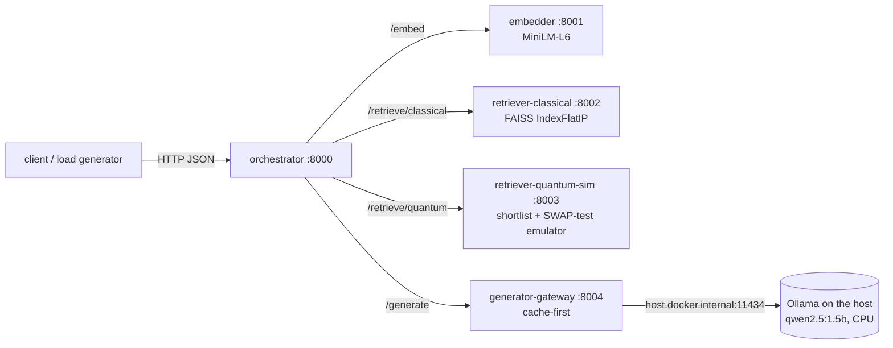

# QRAG-Lab

**Quantum-Inspired Retrieval for Cloud-Native RAG: Investigating Hallucination, Latency, and Scalability Tradeoffs.**

A simulation study of SWAP-test similarity estimation versus exact FAISS cosine retrieval inside a containerised retrieval-augmented generation (RAG) pipeline, on SQuAD v1.1. Everything runs on one CPU-only laptop. It feeds a technical seminar and an IGI Global book chapter.

## Read this first: what this is and is not

- The "quantum" arm is a **classical simulation** of the SWAP test (a real 19-qubit Qiskit/Aer circuit for validation, plus a vectorised binomial emulator for scale). *Quantum-inspired retrieval*, in this work, means a retrieval stage whose similarity scores come from classically simulating a quantum similarity-estimation procedure, including its finite-shot statistics.
- **No quantum speedup is claimed.** Latency of the quantum arm is *emulated-estimator* latency; shots, circuits and gate counts are *modelled* costs, never wall-clock quantum time.
- The study asks what changes when similarity is a shot-limited probabilistic estimate: retrieval quality, ranking stability, and downstream hallucination, holding everything else fixed.
- The cloud-native stack is *emulated on commodity hardware*; no claim is made about real cloud performance.

## Research questions

1. **RQ1 Hallucination**: does swapping exact cosine for an estimated similarity change the rate / type of hallucinated answers?
2. **RQ2 Latency**: what does it cost, and how does it depend on the shot budget; retrieval-only versus end-to-end?
3. **RQ3 Scalability**: how do quality, latency and memory change as the corpus grows?
4. **RQ4 Tradeoff**: where does each arm sit on the hallucination / latency / corpus-size frontier?

Answers, with the evidence and its strength, are in section 3 of [FINDINGS.md](FINDINGS.md).

## Architecture



Per-stage timings travel in every response (body and `Server-Timing` header). Resource profiles for the three compute services (embedder and the two retrievers): small 1 CPU / 1.5 GB, medium 2 CPU / 2 GB, large 4 CPU / 3 GB. Figure F1 shows the same diagram with the Docker boundary.

Retrieval protocol of the quantum arm (two-stage, "shortlist then estimate"): FAISS Flat returns the top-M candidates (M = 50 by default); each is re-scored by `c2_hat = 2k/S - 1` with `k ~ Binomial(S, (1 + cos^2)/2)`; the top-k by estimate go into the prompt. A full-scan variant estimates all N candidates.

## Setup (Windows 11, PowerShell or Git Bash)

Requirements: Python 3.12, Git, [Ollama](https://ollama.com) (for generation; the model is pulled by the Phase 0 benchmark), Docker Desktop (Phase 6 only). Hardware assumed: 8 GB RAM, no GPU used.

```
python tasks.py setup            # creates .venv and installs the pinned requirements.lock
python tasks.py env data bench   # Phase 0: environment report, SQuAD download + checksums, generator gate
```

Docker Desktop memory is capped through `%UserProfile%\.wslconfig` (`memory=3GB`, `processors=4`, `swap=2GB`); see FINDINGS.md Deviations D-6.4.

## Running the study

`python tasks.py <task>` is a cross-platform task runner (no `make` needed). Each phase writes immutable artifacts to `results/<phase>/<run_id>/` with a `run_manifest.json` (git hash, seeds, package versions), and `python tasks.py report` regenerates the machine-written blocks of FINDINGS.md.

| Task | What it does | Notes |
|---|---|---|
| `setup`, `env`, `data`, `bench` | Phase 0 | needs Ollama for `bench` |
| `embed`, `phase1` | corpus, nested ladder, embeddings, exact ground truth | embedding takes ~15 min on CPU |
| `phase2`, `phase3`, `phase4` | FAISS baseline; SWAP-test arm and validation; retrieval-only experiments | minutes |
| `phase5` | RAG generation (resumable, cached), HHEM judging, outcome analysis | hours on CPU; close other apps; stop Ollama before judging |
| `phase6` | containers, HTTP latency, concurrency | Docker Desktop running, Ollama idle |
| `phase7`, `phase8` | tradeoff synthesis; robustness, NLI cross-check, threats | `phase8` loads a model (about 50 min) |
| `phase9` | clean-room reproduction from a fresh clone, tests, numbers audit | about 12 min |
| `figures`, `test`, `report` | figures (PNG 300 dpi + CSV), `pytest`, FINDINGS.md blocks | |

The reproduction check (`python scripts/clean_room.py --run-id <id>`) clones the last commit, re-runs every deterministic stage, and compares the regenerated artifacts with the committed ones. `python scripts/check_numbers.py` verifies that FINDINGS.md contains no hand-typed result numbers.

## Repository map

```
qrag/            core package: embed, corpus, index_classical, quantum_swap (Tier A circuit), emulator (Tier B),
                 rerank, pipeline, generate, judge, metrics, stats, timing, manifest
services/        FastAPI apps (embedder, retrievers, generator-gateway, orchestrator) and schemas
docker/          Dockerfiles;  docker-compose.yml + configs/profiles/*.env define the resource profiles
scripts/         run_phaseN.py (experiments), report*.py (FINDINGS.md generators), make_figures.py,
                 clean_room.py, check_numbers.py
tests/           pytest suite (unit, integration over ASGI, determinism)
data/            eval_set.json, ladder_N.json, SQuAD checksums (large arrays are regenerated, not committed)
results/         raw artifacts per phase and run (immutable), results/figures/ (F1-F10 as PNG + CSV)
docs/            manuscript_source_notes.md, seminar_summary.md, seminar/ (key figures)
FINDINGS.md      the single results file; start here
```

## How to read FINDINGS.md

0. **Master Results Index**: phase, key result, artifact path.
1. **Environment and versions**: hardware, packages, models.
2. **Phase reports**: one generated block per phase with tables, figures, observations and the manuscript hook.
3. **Headline Findings**: answers to RQ1-RQ4, each with its supporting table and an evidence-strength note.
4. **Deviations**, 5. **Failures and limitations**, 7. **Open questions for the human**: hand-written, free of result numbers.
6. **Reproduction commands**.
8. **Manuscript Numbers Sheet** and **Methods Facts Sheet**: every number and parameter quoted in the chapter with the artifact it comes from.

Rules the study follows: one variable changed at a time (only the retrieval scoring stage differs between arms); everything seeded and versioned; raw outputs immutable; every number in FINDINGS.md is generated from an artifact; negative and null results are reported with the same prominence as positive ones.

## Reproducibility notes

- Large artifacts are not committed: raw SQuAD (`data/raw/`, re-download with `python tasks.py data`, checksums are committed), embeddings (`python tasks.py embed`), Phase 3 rankings (`python tasks.py phase3`), the LLM answer cache (`cache/`; the committed `generations.jsonl` carries every answer text and cache key), models and Hugging Face / Ollama caches.
- CPU generation is not bit-reproducible (see FINDINGS.md section 5); exact reruns rely on the answer cache.
- `requirements.lock` pins the environment; no network is needed during measurement runs.
